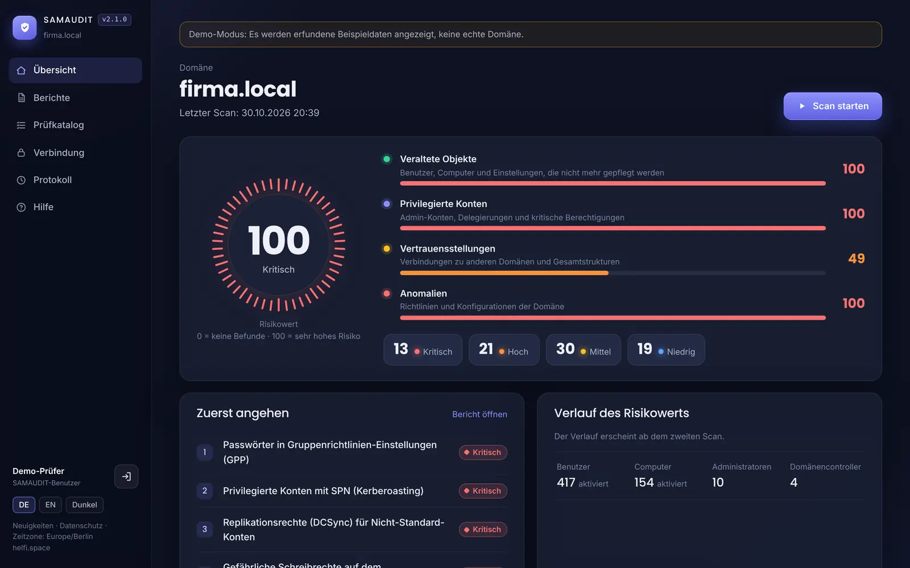
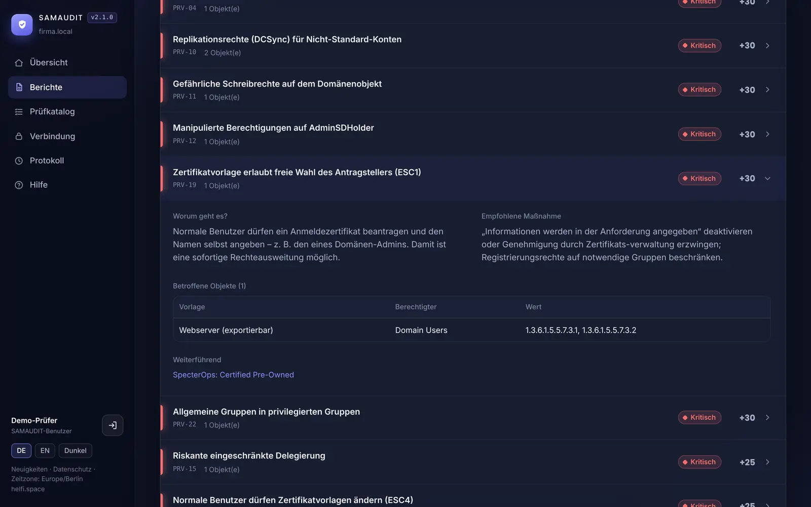
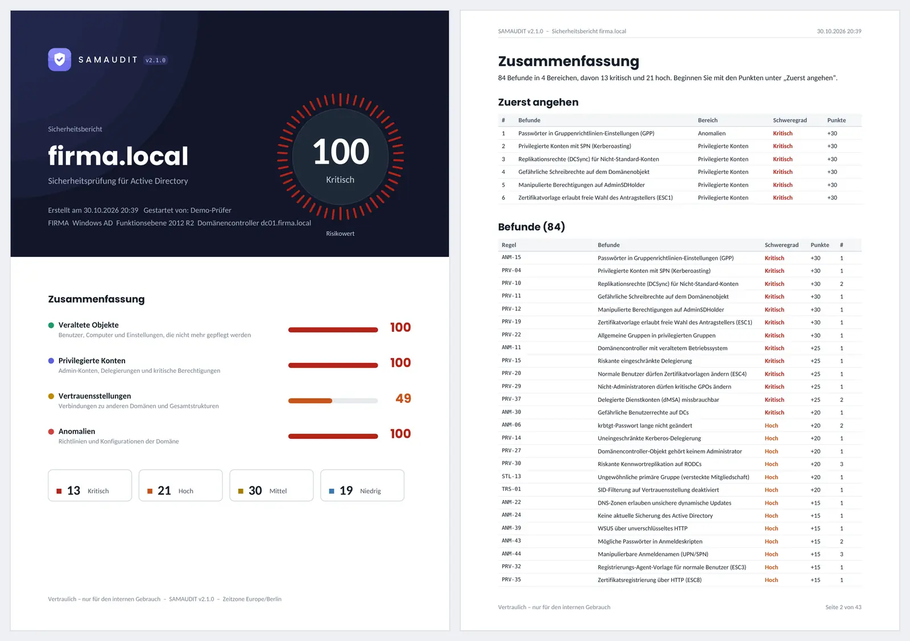

# SAMAUDIT – Sicherheitsprüfung für Active Directory

[English](README.md) · **Deutsch** · [Handbuch](app/docs/handbuch.de.md) · [Änderungen](CHANGELOG.de.md)

<a href="https://buymeacoffee.com/soleil0815"></a>

Selbst gehostete Webanwendung, die eine Windows- oder Samba-AD-Domäne ausliest, **115 Sicherheitsprüfungen** durchführt und das Ergebnis als Risikowert (0–100), detaillierten Bericht mit Maßnahmen und PDF ausgibt – auf Deutsch oder Englisch. Sie läuft als ein einzelner Docker-Container, meldet sich mit einem normalen (Nicht-Admin-)Domänenkonto an und sendet keine Daten nach außen.

> **Status: Beta – Hobbyprojekt, ohne Gewähr.** SAMAUDIT wurde für den eigenen Einsatz entwickelt und vor allem mit Testdaten geprüft; Ergebnisse können unvollständig oder falsch sein und ersetzen keine fachliche Prüfung. Rückmeldungen sind willkommen, Support oder Reaktionszeiten werden nicht zugesagt. Sicherheitslücken bitte vertraulich melden (siehe [SECURITY.md](SECURITY.md)).


*Übersicht nach einem Scan – Risikowert, die vier Bereiche und „Zuerst angehen“*


*Befund im Bericht – worum es geht, was zu tun ist, welche Objekte betroffen sind*


*PDF-Export – Deckblatt mit Zusammenfassung und Liste aller Befunde*

Alle Bilder zeigen den Demo-Modus mit erfundenen Beispieldaten (`DEMO_MODE=true`).

## Schnellstart

Sie brauchen einen Linux-Server (oder ein NAS) mit Docker und Docker Compose, der die Domänencontroller über TCP 636 (LDAPS) und 445 (SMB) erreicht.

**1. Zwei Dateien holen**

```bash
mkdir -p /opt/samaudit && cd /opt/samaudit
curl -fsSLO https://github.com/soleil0815/samaudit/releases/latest/download/docker-compose.yml
curl -fsSL -o .env https://github.com/soleil0815/samaudit/releases/latest/download/env.example
```

**2. Domäne eintragen** – `.env` öffnen (z. B. `nano .env`) und den einzigen Pflichtwert setzen:

```ini
DOMAIN_FQDN=ihredomaene.local
```

Alles andere hat sinnvolle Standardwerte und ist in der Datei erklärt.

**3. Starten**

```bash
docker compose up -d
```

`https://<server>:9400` öffnen. Beim ersten Start erzeugt SAMAUDIT ein selbstsigniertes Zertifikat, daher warnt der Browser einmal ([eigenes Zertifikat verwenden](#eigenes-https-zertifikat)).

**Vor der ersten Anmeldung** die Prüfer-Gruppe `SAMAUDIT-Benutzer` (oder `SAMAUDIT-Users`) im AD anlegen und die *normalen* Benutzerkonten aufnehmen, die die Berichte sehen dürfen – Admin-Konten werden grundsätzlich abgewiesen ([Einzelheiten](#wer-darf-sich-anmelden)):

```powershell
New-ADGroup -Name "SAMAUDIT-Benutzer" -GroupScope Global -GroupCategory Security
Add-ADGroupMember -Identity "SAMAUDIT-Benutzer" -Members "m.muster"
```

**Erst einmal nur ansehen?** In der `.env` `DEMO_MODE=true` setzen, `docker compose up -d` und mit `demo` / `demo` anmelden – ohne Domäne. Für den Echtbetrieb wieder `false`.

**Updates:** `docker compose pull && docker compose up -d` – oder eine Container-Verwaltung (Dockhand, Watchtower, Portainer …) erledigt das. Einstellungen und Daten bleiben erhalten; vor jedem Versionswechsel sichert SAMAUDIT seine Datenbank.

<details>
<summary><b>Mehr: Dockhand/Portainer, DNS-Probleme, welche Datei wem gehört</b></summary>

**Mit Dockhand, Portainer & Co.:** Inhalt der `docker-compose.yml` als Stack anlegen, die Einstellungen aus der `.env` als Umgebungsdatei des Stacks hinterlegen und die Pfade `./data` und `./certs` durch einen festen Ordner ersetzen, z. B. `/opt/samaudit/data`.

**Wo steht was?**

| Datei | Gehört | Bei Updates |
|---|---|---|
| `.env` | Ihnen – alle Einstellungen | bleibt erhalten |
| `docker-compose.override.yml` | Ihnen – eigene Ergänzungen (optional) | bleibt erhalten |
| `data/` | Ihnen – Datenbank, Sicherungen (`data/backups/`), Zertifikate der Oberfläche | bleibt erhalten |
| `certs/` | Ihnen – eigenes HTTPS-Zertifikat (optional) | bleibt erhalten |
| `docker-compose.yml` | SAMAUDIT – nicht bearbeiten | kann durch eine neuere ersetzt werden |
| `update.sh` | SAMAUDIT – optional, für das Update von Hand | |

Nach Änderungen an der `.env`: `docker compose up -d`.

**Eigene Ergänzungen** – z. B. wenn der Container die DC-Namen nicht auflösen kann – gehören in `docker-compose.override.yml` neben der `docker-compose.yml`; Compose liest sie automatisch mit:

```yaml
services:
  samaudit:
    dns: [10.0.10.10, 10.0.10.11]
    extra_hosts: ["dc01.firma.local:10.0.10.10", "dc02.firma.local:10.0.10.11"]
```

Ohne `curl`: Die beiden Dateien hängen auch an jedem [Release](https://github.com/soleil0815/samaudit/releases) (`env.example` als `.env` speichern), oder aus dem Image kopieren: `docker run --rm --entrypoint cat ghcr.io/soleil0815/samaudit:latest /app/dist/docker-compose.yml > docker-compose.yml` (und `/app/dist/.env.example > .env`).

</details>

## Kurzüberblick

| | |
|---|---|
| **Anmeldung** | Mit dem eigenen **normalen** Domänenkonto direkt gegen den Domänencontroller (LDAPS). **Kein Dienstkonto, kein Admin-Konto.** |
| **Zugriff** | Nur Mitglieder der Prüfer-Gruppe (`ALLOWED_GROUPS`, Standard `SAMAUDIT-Benutzer` oder `SAMAUDIT-Users`). Privilegierte Konten werden immer abgewiesen. Geprüft über die effektiven Gruppen (`tokenGroups`, inkl. Verschachtelung). |
| **Scan** | Manuell per Knopfdruck mit den Rechten des angemeldeten Prüfers. Vor jedem Scan wird die Berechtigung erneut geprüft. |
| **Domänentyp** | Windows AD oder Samba AD wird automatisch erkannt. |
| **Bewertung** | Vier Bereiche (Veraltete Objekte, Privilegierte Konten, Vertrauensstellungen, Anomalien), je 0–100 Punkte. Gesamtwert = höchster Bereichswert. |
| **Bericht** | Befunde mit Erklärung, Maßnahme, PowerShell-Beispiel, betroffenen Objekten und Quellen. Vergleich mit dem vorherigen Scan (neu / behoben). |
| **Export** | PDF mit Deckblatt, Zusammenfassung, Domänenüberblick, allen Befunden und Anhang. |
| **Speicher** | SQLite (WAL-Modus) im Ordner `data` im SAMAUDIT-Ordner. |

## LDAPS: automatisches Vertrauen

Standard ist `LDAP_CERT_MODE=auto` – es muss **kein CA-Zertifikat importiert** werden:

1. Beim ersten Kontakt zu einem DC liest SAMAUDIT dessen Zertifikatskette und merkt sich den obersten nachweisbaren Aussteller (meist Ihre Unternehmens-CA, bei Samba das selbst erzeugte Zertifikat).
2. Bei jeder weiteren Verbindung muss die Kette wieder zu diesem gemerkten Zertifikat führen – **bevor** das Passwort gesendet wird.
3. Erneuert die CA das DC-Zertifikat, bleibt das Vertrauen bestehen. Präsentiert jemand ein Zertifikat einer fremden CA (Man-in-the-Middle), wird die Anmeldung abgebrochen und im Protokoll vermerkt.

Zeigt ein Name auf mehrere DCs (z. B. der Domänenname ohne `DC_HOSTS`), wird jedem DC einzeln vertraut; die Einträge heißen dann „firma.local [10.0.0.10]“. Ein neu hinzugekommener DC wird beim ersten Kontakt gemerkt und im Protokoll vermerkt. Wer das nicht möchte, trägt die DCs fest in `DC_HOSTS` ein oder nutzt `LDAP_CERT_MODE=verify`.

Die gemerkten Zertifikate stehen unter **Verbindung**. Nach einem gewollten CA-Wechsel dort zurücksetzen oder per Kommandozeile:

```bash
docker exec samaudit python -m app.pins list
docker exec samaudit python -m app.pins reset                  # alle
docker exec samaudit python -m app.pins reset dc01.firma.local # einzelner DC
```

Weitere Modi: `trust` (immer vertrauen, keine Prüfung – nur Testlabor) und `verify` (klassische Prüfung gegen `LDAP_CA_FILE`, z. B. `ca.pem` im Ordner `certs`). Unverschlüsselte LDAP-Binds sind gesperrt.

## Eigenes HTTPS-Zertifikat

Kein Reverse Proxy nötig – SAMAUDIT liefert HTTPS selbst aus. Am einfachsten über die Weboberfläche:

1. **Verbindung** öffnen → Abschnitt **HTTPS-Zertifikat der Weboberfläche**.
2. Unter **Eigenes Zertifikat hochladen** die Datei(en) auswählen:
   - eine **PFX-Datei** (z. B. Export aus der Windows-Zertifizierungsstelle) + Passwort, **oder**
   - **Zertifikat + privaten Schlüssel** (PEM oder DER; ein verschlüsselter Schlüssel braucht das Passwort).
3. **Hochladen und aktivieren** – das Zertifikat ist sofort aktiv, ohne Neustart. Ggf. die Seite neu laden.

SAMAUDIT prüft vor dem Übernehmen, ob Zertifikat und Schlüssel zusammenpassen, ob das Zertifikat abgelaufen ist und ob es sich als Server-Zertifikat laden lässt; bei Problemen bleibt das bisherige aktiv und die Seite nennt den Grund. Angezeigt werden Aussteller, Ablaufdatum, Fingerabdruck und Warnungen (läuft bald ab, `PUBLIC_HOSTNAME` fehlt im Zertifikat). Mit **Hochgeladenes Zertifikat entfernen** geht es zurück zum vorherigen. Hochladen und Entfernen stehen im Protokoll.

- Das Zertifikat muss den Namen enthalten, unter dem SAMAUDIT aufgerufen wird; setzen Sie `PUBLIC_HOSTNAME` in der `.env` auf diesen Namen.
- Gespeichert wird es als `data/tls/custom/` (Kette + Schlüssel ohne Passwort, nur für den Programmbenutzer lesbar) – wie das selbstsignierte Zertifikat. Das Passwort wird nicht gespeichert. Die Sicherung des Ordners `data` enthält damit auch den Schlüssel.
- Verlängerung: einfach das neue Zertifikat hochladen.

**Alternative ohne Weboberfläche:** Dateien in den Ordner `certs` im SAMAUDIT-Ordner legen (bei PFX `TLS_PFX_PASSWORD` bzw. bei verschlüsseltem Schlüssel `TLS_KEY_PASSWORD` in der `.env`) und `docker compose restart`. Ein hochgeladenes Zertifikat hat Vorrang. Details: `certs/README.txt`.

## Voraussetzungen im Netzwerk

| Vom Container zum DC | Zweck |
|---|---|
| TCP 636 (LDAPS) – oder 389 mit StartTLS | Anmeldung und Datenabfrage |
| TCP 445 (SMB) | SYSVOL/NETLOGON: GPOs, GPP-Passwörter, Skripte, Überwachungs- und Sicherheitsrichtlinien. Abschaltbar mit `SMB_CHECKS=false` (diese Prüfungen erscheinen dann als „nicht prüfbar“). |
| DNS | Der Container muss die DC-Namen auflösen können (sonst `dns` / `extra_hosts` in der `docker-compose.override.yml`, siehe [Schnellstart](#schnellstart)). |

## Ausgehende Verbindungen

SAMAUDIT verbindet sich nur zu den Domänencontrollern. Die programminterne Sperre (`EGRESS_GUARD=true`, Standard) lässt nur Verbindungen zu den DC-Adressen auf den LDAP-/SMB-Ports zu; jeder andere Versuch wird abgewiesen und im Protokoll als „Ausgehende Verbindung blockiert“ vermerkt. Weitere Ziele bei Bedarf mit `EGRESS_ALLOW` (IP, Netz oder Name, durch `;` getrennt). Wer den Container zusätzlich auf Netzwerkebene abschotten möchte, regelt das mit der eigenen Firewall (Docker-Netz `samaudit-net`, Bridge `br-samaudit`).

## Datenschutz (DSGVO)

SAMAUDIT überträgt keine Daten an Dritte, lädt nichts aus dem Internet, setzt nur technisch notwendige Cookies und löscht Berichte und Protokoll automatisch (`REPORT_RETENTION_DAYS`, `AUDIT_RETENTION_DAYS`). Die Seite **„Datenschutz“** (`/privacy`, auch ohne Anmeldung erreichbar) informiert Prüfer und Beschäftigte; die zuständige Stelle tragen Sie in `PRIVACY_CONTACT` ein.

Die Verantwortung für den datenschutzkonformen Einsatz bleibt beim Betreiber. [`DATENSCHUTZ.md`](DATENSCHUTZ.md) enthält eine Vorlage für das Verzeichnis von Verarbeitungstätigkeiten, die technischen und organisatorischen Maßnahmen sowie eine Checkliste (Datenschutzbeauftragte/r, Betriebsrat, Löschfristen).

## Wer darf sich anmelden?

SAMAUDIT wird bewusst **nicht** mit Admin-Konten benutzt. Wer sich in eine Webanwendung mit einem Domänen-Admin-Konto anmeldet, gibt das wertvollste Passwort der Domäne auf einem System ein, das kein Domänencontroller ist (Verstoß gegen das Tier-Modell). Für die Prüfung reichen normale Leserechte.

**1. Prüfer-Gruppe anlegen** und die normalen Benutzerkonten der Personen aufnehmen, die Berichte sehen dürfen (z. B. das Alltagskonto des IT-Leiters – nicht dessen Admin-Konto).

Windows AD:
```powershell
New-ADGroup -Name "SAMAUDIT-Benutzer" -GroupScope Global -GroupCategory Security -Description "Darf SAMAUDIT benutzen"
Add-ADGroupMember -Identity "SAMAUDIT-Benutzer" -Members "m.mustermann"
```

Samba AD:
```bash
samba-tool group add "SAMAUDIT-Benutzer" --description="Darf SAMAUDIT benutzen"
samba-tool group addmembers "SAMAUDIT-Benutzer" m.mustermann
```

**2. Regeln bei der Anmeldung**

| Prüfung | Ergebnis |
|---|---|
| Konto ist in einer privilegierten Gruppe (auch verschachtelt): Domänen-, Organisations-, Schema-Admins, Administratoren, Konten-/Server-/Druck-/Sicherungs-Operatoren, Richtlinien-Ersteller-Besitzer, (Organisations-)Schlüsseladministratoren, DnsAdmins, Domänencontroller – oder ist das eingebaute Administrator-Konto | **abgewiesen** |
| Konto ist in `ALLOWED_GROUPS` | angemeldet |
| sonst | abgewiesen |

Die Gruppen werden über RIDs/SIDs erkannt, also sprachunabhängig. Mit `DENIED_GROUPS` lassen sich weitere Gruppen sperren (z. B. eigene Tier-0-Gruppen); die eingebauten Sperren lassen sich nicht abschalten.

Weitere Schutzmechanismen: Sperre nach 5 Fehlversuchen (pro Benutzer und IP), Sitzungs-Timeout 30 Minuten, CSRF-Schutz, Cookies `HttpOnly` / `Secure` / `SameSite=Strict`, Content-Security-Policy, Protokoll aller Anmeldungen (auch abgewiesener), Scans und Zertifikatsereignisse.

**Was passiert mit dem Passwort?** Es wird nach der Anmeldung verschlüsselt (Schlüssel nur im Arbeitsspeicher) für die Dauer der Sitzung gehalten, damit ein Scan mit Ihren Rechten laufen kann. Es wird nie in die Datenbank, auf die Festplatte oder in Logs geschrieben.

## Windows AD oder Samba AD – automatische Erkennung

Mit `DOMAIN_TYPE=auto` (Standard) liest SAMAUDIT beim Verbinden das rootDSE des DCs. Samba meldet sich dort mit `vendorName: Samba Team`; zusätzlich wird das Betriebssystem der DC-Objekte geprüft. Der erkannte Typ steht unter **Verbindung** und im Bericht und steuert, welche Windows-spezifischen Prüfungen ausgeführt werden. Mit `windows` oder `samba` lässt er sich bei Bedarf fest einstellen.

`DC_HOSTS` ist optional: Ohne Angabe wird der Domänenname verwendet, der in AD und Samba auf alle DCs auflöst. Bei **mehreren Samba-DCs** mit jeweils eigenem selbstsigniertem Zertifikat sollten Sie `DC_HOSTS` mit den einzelnen DC-Namen setzen, damit das LDAPS-Autovertrauen pro DC funktioniert.

## Prüfkatalog (115 Prüfungen)

Der vollständige Katalog mit Beschreibung und Punkten steht in der Anwendung unter **Prüfkatalog**.

**Veraltete Objekte (22):** inaktive Benutzer und Computer, „Passwort läuft nie ab“, PASSWD_NOTREQD, umkehrbare Verschlüsselung, DES (Flag und Verschlüsselungstypen), AS-REP-Roasting, Kerberoasting, Betriebssysteme ohne Support (inkl. Windows 10 seit 14.10.2025, Server 2016 ab 01/2027), SID-Verlauf, versteckte Mitgliedschaft über primäre Gruppe, userPassword-Attribute, LAPS-Abdeckung, verwaiste adminCount-Markierungen, nicht erneuerte Maschinenkennwörter, Replikationskonflikte (CNF), fehlende AD-Subnetze, Konten, die noch Kerberos-RC4 brauchen, schwache Zertifikatszuordnungen (altSecurityIdentities).

**Privilegierte Konten (41):** Anzahl Admins, Schema-/Organisations-Admins, Operator-Gruppen, Key Admins / GPO-Ersteller, allgemeine Gruppen (Jeder, Domänen-Benutzer …) in Admin-Gruppen, Admins mit SPN oder ohne Vorauthentifizierung, Delegierungsschutz / Protected Users, inaktive, deaktivierte und alte Admin-Konten, Shadow Credentials, DCSync-Rechte, Schreibrechte auf Domänenobjekt, AdminSDHolder, OU „Domain Controllers“ und kritischen GPOs, Besitzer der DC-Objekte, RODC-Kennwortreplikation, DnsAdmins, uneingeschränkte / eingeschränkte / ressourcenbasierte Delegierung, „Prä-Windows 2000“-Gruppe, Entra ID Seamless SSO, AD CS: ESC1, ESC2, ESC3, ESC4, ESC5, ESC8, ESC9, ESC13, ESC15, ESC17, Certighost (CVE-2026-54121), delegierte Dienstkonten (dMSA, „BadSuccessor“), Leserechte auf den KDS-Stammschlüssel (Golden gMSA/dMSA), gMSA-Kennwortabruf durch zu viele.

**Vertrauensstellungen (7):** SID-Filterung, TGT-Delegierung, inaktive/defekte Trusts, Downlevel-Trusts, fehlendes AES, fremde Konten in Admin-Gruppen, fehlende selektive Authentifizierung.

**Anomalien (45):** Passwortrichtlinie (Länge, Sperre, Komplexität, Chronik, Mindestalter, umkehrbar) und PSOs, krbtgt-Passwortalter (inkl. RODC-krbtgt), Gastkonto, MachineAccountQuota, AD-Papierkorb, Funktionsebene, DC-Betriebssysteme, Anzahl/Zustand/Ort der DCs, AD-Sicherung, Tombstone-Lebensdauer, SYSVOL-Replikation (FRS), dSHeuristics (anonymer Zugriff, AdminSDHolder-Ausnahmen), DNS (unsichere Updates, ADIDNS-Rechte), CA-Zertifikate (SHA-1/MD5, Schlüssellänge, Ablauf), GPP-Passwörter und Autologon, Passwörter in Anmeldeskripten, und auf Basis der Gruppenrichtlinien: LDAP-Signierung und Kanalbindung, NTLMv1/LM-Hashes, SMB-Signierung (Server und Client), Druckwarteschlange auf DCs, Überwachungsrichtlinie auf DCs, gefährliche Benutzerrechte auf DCs, ZeroLogon-Ausnahmen, RefusePasswordChange, Kerberos-Verschlüsselungstypen, WDigest, AlwaysInstallElevated, WSUS über HTTP, LLMNR, PowerShell-Protokollierung, LSA-Schutz, leere Kennwörter und anonymer Zugriff per GPO; manipulierbare UPN/SPN (unsichtbare Zeichen, Namensgleichheit, Dubletten, Eindeutigkeitsprüfung).

Prüfungen, die in einer Umgebung nicht möglich sind (z. B. Windows-spezifische Punkte bei Samba oder SYSVOL ohne SMB-Zugang), erscheinen unter „Nicht prüfbar“ und zählen nicht in den Risikowert.

## Grenzen

- Der Scan läuft mit normalen Benutzerrechten. Einige wenige Daten sind dann nicht lesbar (Fine-Grained Password Policies, auf RODCs zwischengespeicherte Passwörter, vertrauliche Attribute wie `unixUserPassword`). Die betroffenen Prüfungen erscheinen als „nicht prüfbar“, nicht als „bestanden“.
- Der Bericht ist eine automatisierte Momentaufnahme und ersetzt keinen Penetrationstest.
- Einstellungen, die nur lokal in der Registry oder per RPC sichtbar sind, werden nicht live abgefragt. Signierung, NTLM-Stufe, Druckwarteschlange, Benutzerrechte und Überwachung werden aus den GPOs auf Domäne und OU „Domain Controllers“ abgeleitet; domänenweite Einstellungen (LLMNR, WSUS …) aus allen verknüpften GPOs.
- Die Prüfregeln, Texte und Bewertungen sind eigenständig erstellt und orientieren sich an öffentlich dokumentierten Angriffstechniken (MITRE ATT&CK, Microsoft-Empfehlungen, BSI, SpecterOps „Certified Pre-Owned“).

## Betrieb

```bash
docker compose ps                         # Zustand (healthy = bereit)
docker compose logs -f                    # Logs
docker compose up -d                      # nach Änderungen an der .env
docker compose restart                    # nach Änderungen im Ordner certs/
curl -k https://localhost:9400/healthz    # Version und Zustand
```

### Update

**Mit einer Container-Verwaltung (empfohlen):** Dockhand, Watchtower, Tugtainer o. Ä. den Container `samaudit` aktualisieren lassen. Mit `SAMAUDIT_VERSION=latest` kommen jede neue Version und jedes wöchentliche Sicherheitsupdate automatisch. **Empfehlung: Update-Zeit nachts** (z. B. 03:00) – ein Neustart bricht einen gerade laufenden Scan ab (er wird als „Abgebrochen“ markiert und kann neu gestartet werden).

**Von Hand:**

```bash
docker compose pull && docker compose up -d
```

oder `sh update.sh` – das merkt sich zusätzlich die laufende Version als `previous`, wartet auf den Gesundheitscheck und startet bei Problemen wieder die vorige Version (nach Rückfrage, mit `-y` automatisch). Ist die `docker-compose.yml` im Image neuer, legt es sie ab und behält die bisherige als `docker-compose.yml.alt`. `update.sh` läuft mit `/bin/sh`, auch auf einem NAS (z. B. Synology), und braucht Docker mit Compose.

**Bei jedem Versionswechsel – egal, wie das Update kommt** – sichert SAMAUDIT beim ersten Start die Datenbank nach `data/backups/samaudit-vor-<Version>-<Zeit>.db` und passt erst danach die Datenbank an. Die letzten 5 dieser Sicherungen bleiben (`BACKUP_KEEP`). Ist die `docker-compose.yml` veraltet, steht ein Hinweis im Log und auf der Übersicht.

### Version festlegen und zurückgehen

Eine bestimmte Version verwenden: in der `.env` z. B. `SAMAUDIT_VERSION=2.0.0` eintragen (oder ein Sicherheitsupdate davon, z. B. `2.0.0-s1`; die Versionen stehen unter *Releases* auf GitHub), dann `docker compose up -d` – oder `sh update.sh --version=2.0.0`. Zurück zur jeweils neuesten Version: `SAMAUDIT_VERSION=latest`.

**Auf eine ältere Version zurückgehen:** Eine ältere Version startet nicht auf der Datenbank einer neueren, sondern meldet im Log, welche Sicherung zurückzuspielen ist. Deshalb in dieser Reihenfolge:

```bash
docker compose stop
docker compose run --rm samaudit restore      # Sicherungen anzeigen, Nummer wählen
# z. B. von 2.1.0 zurück auf 2.0.0: die Sicherung „samaudit-vor-2.1.0-…“ wählen
# (Stand, bevor 2.1.0 die Datenbank übernommen hat)
nano .env                                     # SAMAUDIT_VERSION=2.0.0
docker compose up -d
```

Mit `update.sh` in einem Schritt: `sh update.sh --restore --version=2.0.0` (zeigt die Sicherungen, spielt die gewählte zurück und startet dann 2.0.0). Die Datenbank vor dem Zurückspielen wird als `samaudit-ersetzt-<Zeit>.db` aufgehoben. Berichte, die nach der Sicherung entstanden sind, fehlen danach. Versionen vor 2.0 kennen diese Prüfung noch nicht – für einen Rückschritt auf 1.x immer zuerst die Sicherung `samaudit-vor-2.0.0-…` zurückspielen.

### Ohne Internet

1. Auf einem Rechner mit Internet aus dem GitHub-Release herunterladen: die Image-Datei für den Server (`samaudit-<Version>-amd64.tar.gz`; Server/NAS mit ARM-Prozessor: `…-arm64.tar.gz`) und `SHA256SUMS`, für eine neue Installation auch `docker-compose.yml`, `env.example` (als `.env.example` speichern) und `update.sh`.
2. Die Dateien in den SAMAUDIT-Ordner auf dem Server kopieren.
3. `sh update.sh --load samaudit-<Version>-amd64.tar.gz` – prüft die Prüfsumme, lädt das Image (`docker load`), trägt `SAMAUDIT_VERSION` in die `.env` ein, startet und prüft. Ohne `update.sh`: `docker load -i <Datei>`, `SAMAUDIT_VERSION=<Version>` in die `.env`, `docker compose up -d`.

### Umstieg von Version 1.x

Bis 1.9 startete `update.sh` den Container selbst (`docker run`), mit ZIP-Paketen und Programmdateien im Ordner. Einmalig umstellen:

1. Neue `update.sh` holen (ersetzt die alte):
   ```bash
   cd /opt/samaudit
   docker pull ghcr.io/soleil0815/samaudit:latest
   docker run --rm --entrypoint cat ghcr.io/soleil0815/samaudit:latest /app/dist/update.sh > update.sh
   ```
2. `sh update.sh` – erkennt die alte Installation, legt `docker-compose.yml` an, übernimmt `DOCKER_DNS`/`DOCKER_EXTRA_HOSTS` in die `docker-compose.override.yml`, ersetzt den alten Container (die Daten bleiben), SAMAUDIT sichert die Datenbank (`samaudit-vor-2.0.0-…`) und startet. Startet die neue Version nicht, läuft wieder die alte.
3. `sh update.sh --cleanup` – listet die nicht mehr gebrauchten Dateien früherer Versionen (Programmdateien, ZIP-Pakete, entpackte Versionsordner, Zwischenstände, die Host-Firewall älterer Versionen, lokal gebaute Images), fragt nach und löscht nur diese. Nie angefasst werden `.env`, `docker-compose*.yml`, `data/`, `backups/`, `certs/`, `update.sh` und alles, was ein Container einbindet – auch nicht über symbolische Links.
4. Ab jetzt: Container-Verwaltung oder `docker compose pull && docker compose up -d`. Die alten Sicherungen in `backups/` bleiben liegen und können bei Bedarf von Hand gelöscht werden.

**Wird der Container schon als Stack in Dockhand/Portainer verwaltet?** Dann den Stack-Inhalt durch die neue `docker-compose.yml` ersetzen (Pfade anpassen, `dns`/`extra_hosts` bei Bedarf ergänzen) und den Stack neu starten – `update.sh` wird dafür nicht gebraucht und lässt fremde Stacks auch nicht an.

### Datenordner und Sicherung

Alles, was SAMAUDIT speichert, liegt in `./data`:

| Datei | Inhalt |
|---|---|
| `samaudit.db` + `-wal`/`-shm` | Berichte, Protokoll, gemerkte DC-Zertifikate |
| `backups/samaudit-vor-<Version>-<Zeit>.db` | automatische Sicherung vor jedem Versionswechsel (die letzten 5) |
| `tls/cert.pem`, `tls/key.pem` | selbstsigniertes Zertifikat der Weboberfläche |
| `tls/custom/` | über die Weboberfläche hochgeladenes Zertifikat (Kette + Schlüssel) |

Eine vollständige Sicherung ist der ganze Ordner – für eine konsistente Kopie den Container kurz anhalten:

```bash
docker compose stop
sudo tar czf samaudit-backup-$(date +%F).tgz data .env
docker compose start
```

Der Ordner gehört im laufenden Betrieb dem Programmbenutzer (UID 10001) und ist nur für ihn lesbar; zum Ansehen auf dem Host `sudo` verwenden. Datenbank, Sicherungen und PDF-Exporte enthalten Schwachstellen Ihrer Domäne – entsprechend vertraulich behandeln.

**Selbst bauen (Entwickler):** `docker build -t samaudit:dev .` im Quellcode, dann in der `.env` `SAMAUDIT_IMAGE=samaudit` und `SAMAUDIT_VERSION=dev` und `docker compose up -d`.

## Alle Einstellungen

Alle Werte werden in der `.env` gesetzt (Schreibweise `NAME=wert`, Vorlage mit Erklärungen: `.env.example`). Nicht gesetzte Werte nehmen den Standard.

| Variable | Standard | Beschreibung |
|---|---|---|
| `DOMAIN_FQDN` | – | DNS-Name der Domäne (Pflicht) |
| `DOMAIN_TYPE` | `auto` | `auto` (erkennen), `windows` oder `samba` |
| `DOMAIN_NETBIOS` | automatisch | NetBIOS-Name |
| `DC_HOSTS` | `DOMAIN_FQDN` | DCs, mit `;` getrennt (der erste erreichbare wird genutzt) |
| `LDAP_SSL` / `LDAP_PORT` | `true` / `636` | LDAPS |
| `LDAP_STARTTLS` | `false` | StartTLS auf 389 statt LDAPS |
| `LDAP_CERT_MODE` | `auto` | `auto` (automatisch vertrauen und merken), `trust`, `verify` |
| `PIN_RESET_WEB` | `false` | gemerkte DC-Zertifikate in der Weboberfläche zurücksetzen erlauben (sonst nur `docker exec samaudit python -m app.pins reset`) |
| `LDAP_CA_FILE` | – | CA-Zertifikat (PEM) im Ordner `certs`, nur für `verify` |
| `LDAP_TIMEOUT` | `10` | Sekunden |
| `ALLOWED_GROUPS` | `SAMAUDIT-Users` und `SAMAUDIT-Benutzer` | Prüfer-Gruppe(n): Name, DN, SID oder `RID:x`. Ohne Einstellung gelten beide Namen; mit Einstellung genau die angegebenen Gruppen. |
| `DENIED_GROUPS` | – | zusätzlich gesperrte Gruppen (die eingebauten Sperren gelten immer) |
| `PORT` | `9400` | Port der Weboberfläche auf dem Server (im Container immer 9400) |
| `TLS_ENABLED` | `true` | HTTPS im Container. Hinter einem Reverse-Proxy: `false`, `TRUSTED_PROXIES=<Proxy-IP>`, `COOKIE_SECURE=true` |
| `TLS_PFX_PASSWORD` | – | Passwort der PFX-Datei im Ordner `certs` |
| `TLS_KEY_PASSWORD` | – | Passwort eines verschlüsselten privaten Schlüssels |
| `TLS_PFX` / `TLS_CERT` / `TLS_KEY` | automatisch | nur nötig, wenn im Ordner `certs` mehrere Zertifikate liegen (Dateiname) |
| `PUBLIC_HOSTNAME` | Containername | Name im selbstsignierten Zertifikat |
| `TZ` | `Europe/Berlin` | Zeitzone für Anzeige, PDF und Logs |
| `SESSION_TIMEOUT_MIN` | `30` | Inaktivität bis zur Abmeldung |
| `MAX_LOGIN_ATTEMPTS` / `LOCKOUT_MIN` | `5` / `15` | Sperre nach Fehlversuchen |
| `INACTIVE_DAYS` | `180` | ab wann Konten als inaktiv gelten |
| `ADMIN_INACTIVE_DAYS` | `90` | dto. für Admins |
| `KRBTGT_MAX_DAYS` | `180` | maximales Alter des krbtgt-Passworts |
| `SMB_CHECKS` / `SMB_TIMEOUT` | `true` / `15` | SYSVOL-/NETLOGON-Prüfungen |
| `DEFAULT_LANG` | `de` | `de` oder `en` (umschaltbar in der Oberfläche) |
| `DEMO_MODE` | `false` | Beispieldaten, Anmeldung demo/demo |
| `EGRESS_GUARD` | `true` | programminterne Sperre ausgehender Verbindungen (nur DCs) |
| `EGRESS_ALLOW` | – | weitere erlaubte Ziele (IP, Netz, Name; `;`-getrennt) |
| `REPORT_RETENTION_DAYS` | `365` | Berichte nach x Tagen löschen (`0` = nie) |
| `AUDIT_RETENTION_DAYS` | `90` | Protokoll nach x Tagen löschen (`0` = nie) |
| `PRIVACY_CONTACT` | – | Ansprechpartner auf der Datenschutzseite |
| `LOG_LEVEL` | `INFO` | |
| `SAMAUDIT_VERSION` | `latest` | Version des Images (z. B. `2.0.0` oder `2.0.0-s1`) |
| `SAMAUDIT_IMAGE` | `ghcr.io/soleil0815/samaudit` | anderes Image, z. B. ein Fork |
| `BACKUP_KEEP` | `5` | Anzahl der automatischen Sicherungen vor Versionswechseln (`0` = alle behalten) |

## Sicherheitsupdates und Versionen

**Feste Versionen.** Was ins Image kommt, steht vollständig im Repository: Basisimage mit Version und Digest (`Dockerfile`, `ARG PYTHON_IMAGE`), Debian-Paketstand als Datum auf snapshot.debian.org (`ARG DEBIAN_SNAPSHOT`) mit der erwarteten Paketliste (`locks/os-packages.txt`), alle Python-Pakete mit Version und Prüfsummen (`requirements.txt`, Testwerkzeuge in `requirements-dev.txt`). Die gewünschten Pakete stehen in `requirements.in`; `tools/update-locks.sh` berechnet daraus alles neu.

**Der Unterbau** ist in `tools/lock-policy.env` festgelegt: Debian 13 „trixie“ (steht im Namen des Basisimages, nie ein Tag, das sich still ändert) und Python 3.13. Er wird nie automatisch gewechselt.

**Wöchentliches Sicherheitsupdate** (`.github/workflows/security-update.yml`, montags 03:17 UTC, von Hand unter *Actions → Security update → Run workflow*):

1. neue Versionen ermitteln, **nur innerhalb des Unterbaus**: neueste Python-3.13-Version auf Debian 13, alle Debian-Pakete auf dem Stand des Tages (auch die des Basisimages), jedes Python-Paket innerhalb seiner Hauptversion – vor 1.0 innerhalb der Nebenversion. Kalenderversionen (tzdata, certifi) haben keine Grenze.
2. Hat sich nichts geändert: Ende, es wird nichts veröffentlicht.
3. ohne Cache bauen, pip und apt entfernen, Tests im fertigen Image, Trivy-Scan.
4. Nur wenn alles bestanden ist: Image bauen, genau dieses prüfen und als `<Version>-s<n>` und `latest` veröffentlichen, Eintrag in [CHANGELOG-SECURITY.md](CHANGELOG-SECURITY.md) mit den geänderten Paketen, Git-Tag und GitHub-Release. Der Zähler `n` beginnt bei jeder neuen Programmversion wieder bei 1 (`1.9.7-s1`, `1.9.7-s2`, … `1.9.8-s1`).

**Trivy** wird als feste Version mit geprüfter SHA-256-Prüfsumme geladen (keine Trivy-GitHub-Action – deren Tags waren im März 2026 kompromittiert, CVE-2026-33634). Nur Funde **CRITICAL/HIGH mit verfügbarer Korrektur** stoppen eine Veröffentlichung; alles andere steht im Bericht (Zusammenfassung und Artefakt `trivy-report`). Bewusst akzeptierte Funde stehen in `.trivyignore`, jeweils mit Begründung und Ablaufdatum (`CVE-… exp:JJJJ-MM-TT  # Grund`); nach dem Datum meldet Trivy sie wieder.

**Tägliche Prüfung** (`scan-published.yml`, 05:43 UTC): scannt das veröffentlichte `latest` erneut, weil Schwachstellen oft erst nach dem Bau bekannt werden, und prüft wie ein anonymer Nutzer, dass sich das Image (amd64 und arm64) holen und die Dateien der Kurzanleitung aus dem neuesten Release herunterladen lassen.

**Unterbau-Warnung** (jeden Montag, Teil des Sicherheitsupdates): fragt bei endoflife.date ab, bis wann Python 3.13 und Debian 13 Sicherheitsupdates bekommen. Weniger als 12 Monate: Hinweis am Lauf. Weniger als 6 Monate: der Lauf wird rot.

**Wenn ein Lauf rot ist** – GitHub schickt dann eine E-Mail (an das Konto, das den Zeitplan zuletzt geändert hat). Es wurde nichts veröffentlicht, `latest` bleibt auf dem letzten geprüften Stand; der Grund steht oben am Lauf (Annotation und Zusammenfassung).

| Meldung | Was tun |
|---|---|
| *Trivy found CRITICAL/HIGH vulnerabilities* | Oft liefert Debian oder das Paket die Korrektur in den nächsten Tagen nach – den nächsten Montag abwarten oder den Lauf später von Hand starten. Bleibt er rot: das betroffene Paket gezielt anheben (neue Programmversion) oder den Fund nach Bewertung mit Begründung und Ablaufdatum in `.trivyignore` eintragen. |
| *Security update: versions not determinable* / Bau fehlgeschlagen | Meist war eine Quelle kurz nicht erreichbar – Lauf neu starten. Bleibt er rot, passt eine neue Paketversion nicht; dann gezielt prüfen. |
| Tests im Image fehlgeschlagen | Eine neue Paketversion verhält sich anders. Nichts veröffentlicht; Paket prüfen und ggf. in `requirements.in` begrenzen. |
| *Lift the base soon* (Hinweis) | Wechsel auf die nächste Python- bzw. Debian-Version einplanen. |
| *Lift the base* (rot) | Unterbau bewusst anheben: `tools/lock-policy.env` ändern, `tools/update-locks.sh --major`, testen und als neue Programmversion veröffentlichen. |
| Tägliche Prüfung rot: *Trivy …* | Im veröffentlichten Image wurde eine neue Schwachstelle bekannt. Gibt es eine Korrektur, das Sicherheitsupdate von Hand starten; sonst wie bei Trivy oben. |
| Tägliche Prüfung rot: *Image not publicly reachable* / *Release file missing* | Das Paket oder eine Release-Datei ist nicht mehr öffentlich. *Packages → samaudit → Package settings → Sichtbarkeit* und das neueste Release prüfen, dann *Daily checks* von Hand starten. |

## GitHub: Repository und Container-Image

Das Container-Image wird auf GitHub gebaut und in der GitHub Container Registry veröffentlicht (`.github/workflows/docker-image.yml` für Programmversionen, `security-update.yml` und `scan-published.yml` siehe oben):

| Ereignis | Ergebnis |
|---|---|
| Pull Request, Push auf `main` | Selbsttests, Bau aus den festen Versionen, Tests im Image, echter Durchlauf des Update-Wegs mit Docker Compose (Umstieg, Rückfall, Zurückspielen, Aufräumen), Trivy – nichts wird veröffentlicht. Pull Requests führt der Besitzer zusammen, nie automatisch. |
| manueller Start auf `main` (*Actions → Container image → Run workflow*) | wenn `app/version.py` eine neue Version enthält: Image `<Version>` und `latest` (falls höchste Version), Git-Tag `v<Version>`, GitHub-Release (Text aus `app/docs/news.json`) mit Image-Dateien für amd64/arm64, `SHA256SUMS`, `docker-compose.yml`, `env.example` und `update.sh`. Eine schon veröffentlichte Version wird nie neu gebaut oder überschrieben. |
| montags 03:17 UTC | Sicherheitsupdate `<Version>-s<n>` (siehe oben) |
| täglich 05:43 UTC | Prüfung der öffentlichen Erreichbarkeit und Scan des veröffentlichten `latest` |

Gebaut wird für `linux/amd64` und `linux/arm64`, ohne Cache; das gebaute Image wird zuerst ohne Tag hochgeladen, genau dieses wird geprüft (Paketliste, Tests, Trivy) und erst dann mit Tags versehen. Es enthält SBOM und Provenance-Angaben.

**Neue Version veröffentlichen:** Version in `app/version.py` erhöhen, Eintrag in `app/docs/news.json` ergänzen, Pull Request zusammenführen – danach den Lauf *Container image* auf `main` von Hand starten. Nach wenigen Minuten stehen Image (`latest` und `<Version>`), Tag und Release bereit. Sicherheitsupdates entstehen ohne Zutun jeden Montag. Container-Verwaltungen, die `latest` beobachten, holen beides von selbst.

## Unterstützen

SAMAUDIT ist kostenlos und bleibt es. Wenn es Ihnen Zeit spart und Sie Danke sagen möchten, können Sie mir einen Kaffee spendieren: **[buymeacoffee.com/soleil0815](https://buymeacoffee.com/soleil0815)**. Fehlermeldungen und Ideen sind genauso willkommen – siehe [CONTRIBUTING.md](CONTRIBUTING.md).

## Lizenz und Nutzung

Webseite: [helfi.space](https://helfi.space)

SAMAUDIT ist freie Software unter der **GNU Affero General Public License v3.0 oder später** (AGPL-3.0-or-later), Lizenztext in `LICENSE`, Copyright-Hinweis in `NOTICE`. Wer SAMAUDIT verändert und anderen über ein Netzwerk zur Verfügung stellt, muss den geänderten Quellcode ebenfalls bereitstellen. Verwendete Bibliotheken und Schriften: `THIRD-PARTY-NOTICES.md`.

**Nutzungshinweis:** SAMAUDIT ist ein Prüfwerkzeug für Administratoren und Sicherheitsverantwortliche. Verwenden Sie es nur in Domänen, für die Sie ausdrücklich berechtigt sind. Die Software wird **ohne jede Gewährleistung** bereitgestellt; die Bewertungen sind Hinweise und ersetzen keine fachliche Prüfung. Für Schäden durch Einsatz oder Fehlinterpretation der Ergebnisse wird keine Haftung übernommen (siehe Abschnitte 15 und 16 der Lizenz).

Microsoft, Windows und Active Directory sind Marken der Microsoft Corporation; Samba ist eine Marke der Software Freedom Conservancy. SAMAUDIT steht in keiner Verbindung zu diesen Unternehmen oder zu anderen AD-Prüfwerkzeugen.

**Sicherheitslücken** bitte nicht als öffentliches Issue melden, sondern wie in `SECURITY.md` beschrieben.

## Aufbau

```
app/
  version.py     Name und Version
  main.py        Webanwendung (Starlette), Routen, Sicherheits-Header
  auth.py        Sitzungen, Sperre bei Fehlversuchen, CSRF
  ruleids.py     Regel-IDs (STL/PRV/TRS/ANM) und Zuordnung alter IDs
  ldapsrc.py     LDAP-Anmeldung, Berechtigungsprüfung, Datensammlung
  pins.py        LDAPS-Autovertrauen (Zertifikat merken und prüfen)
  webcert.py     HTTPS-Zertifikat (eigenes aus certs/ oder selbstsigniert)
  mdhelp.py      Handbuch als Hilfe-Seite
  docs/          Handbuch (handbuch.de.md, manual.en.md)
  egress.py      Ausgangssperre (nur Verbindungen zu den DCs)
  sysvol.py      SYSVOL/NETLOGON über SMB (GPP, GptTmpl.inf, Registry.pol, audit.csv, Skripte)
  analysis.py    Gruppenauflösung, privilegierte Konten, GPO-Zuordnung
  rules.py       Prüfregeln Teil 1, rules2.py Teil 2 (Texte DE/EN)
  scanner.py     Scan-Ablauf und Bewertung
  pdfreport.py   PDF-Export (ReportLab)
  db.py          SQLite
  i18n.py        Oberflächentexte DE/EN
  demo.py        Beispieldomäne für DEMO_MODE
  templates/ static/ pdf_fonts/
  datastate.py   Sicherung vor Versionswechsel, Schutz vor Rückschritt, Compose-Versionsprüfung
  restore.py     Sicherung zurückspielen (docker compose run --rm samaudit restore)
docker-compose.yml                Start mit Docker Compose (wird mit dem Image ausgeliefert)
.env.example                      Vorlage für Ihre Einstellungen (.env)
update.sh                         Update von Hand: previous, Rückfall, --load, --restore, --cleanup
requirements.in / requirements.txt  Python-Abhängigkeiten (Wunschliste / feste Versionen mit Prüfsummen)
tools/clean-history.sh  Git-Historie ohne persönliche Namen/E-Mail-Adressen neu schreiben (im Repository selbst oder in ein neues)
DATENSCHUTZ.md                    Datenschutz-Unterlagen
```

Schriften: Inter und Poppins (Oberfläche), Carlito, Poppins und DejaVu Sans Mono (PDF) – SIL Open Font License bzw. freie Lizenz, Lizenztexte liegen bei.
