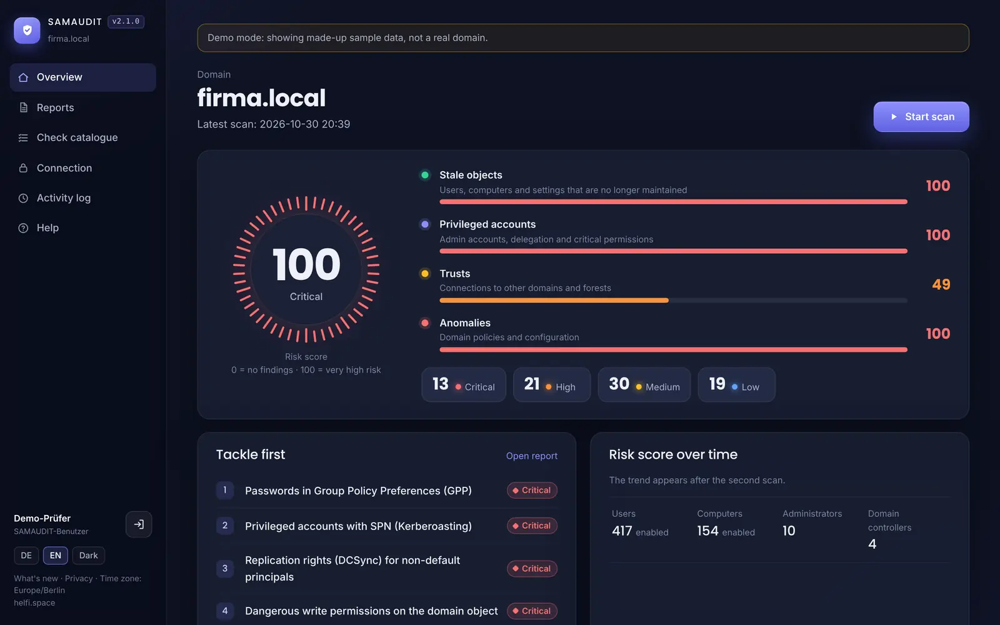
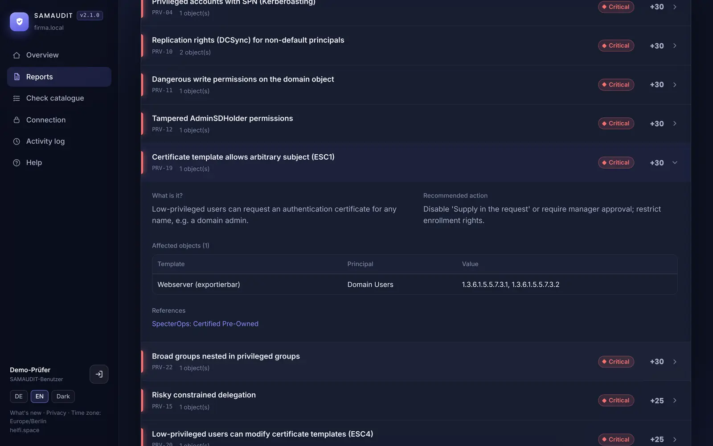
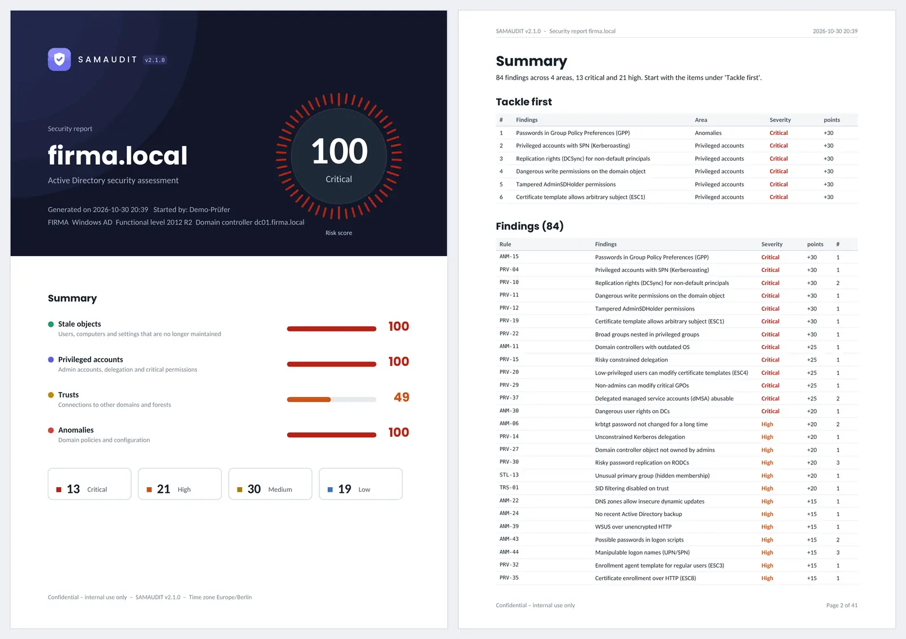

# SAMAUDIT v2.1.0 – Active Directory security assessment

*Deutsche Version: [README.md](README.md)* · **Manual:** [app/docs/manual.en.md](app/docs/manual.en.md) (also in the web interface under **Help**)

Self-hosted web application that reads a Windows or Samba AD domain, runs **115 security checks** and presents the result as a risk score (0–100), a detailed report with remediation advice, and a PDF export – in German or English.

> **Status: beta – hobby project, no warranty.** SAMAUDIT was built for the author's own use and has mainly been tested with test data; results may be incomplete or wrong and do not replace expert review. Feedback is welcome, but no support or response times are promised. Please report security vulnerabilities privately (see [SECURITY.md](SECURITY.md)).


*Overview after a scan – risk score, the four areas and the findings to address first*


*Finding in the report – what it is about, what to do, which objects are affected*


*PDF export – cover page with summary and list of all findings*

All images show demo mode with made-up sample data (`DEMO_MODE=true`).

## New in 2.1.0 – five new checks (now 115)

- **ESC13 (PRV-38):** certificate templates whose issuance policy is linked to an AD group – whoever may enroll gets the group's rights without membership (critical if the group is privileged).
- **Golden gMSA/dMSA (PRV-39):** anyone besides Domain/Enterprise Admins and DCs who may read the KDS root key (or grant themselves that right) can compute all gMSA and dMSA passwords forever. The key itself is never retrieved. With an ordinary account the key objects are usually invisible; SAMAUDIT then checks the inherited rights and reports the rest as "not checkable".
- **gMSA password retrievable by too many (PRV-40):** broad groups such as Domain Users or Domain Computers in msDS-GroupMSAMembership; for privileged gMSAs also individual non-admins.
- **Certighost, CVE-2026-54121 (PRV-41):** users may create computer accounts and an enterprise CA offers a logon template (e.g. "Machine") to domain computers or all users – domain takeover is possible as long as the CA lacks the July 2026 update. As SAMAUDIT cannot see the patch level and this is the default in many domains, the check is a low-weighted reminder.
- **Group Policy weakens logon protection (ANM-45):** blank passwords for network logon, anonymous SAM enumeration, Everyone permissions for anonymous users, anonymous access to named pipes/shares (like PingCastle A-LimitBlankPasswordUse / A-AnonymousAuthorizedGPO).
- **Windows Server 2016 (STL-11):** scored from 90 days before end of support (12 Jan 2027), more urgent for domain controllers; afterwards the systems automatically count as unsupported (previously they would have stayed "expiring" forever).
- **NTLMv1 (ANM-17):** note on the October 2026 update that blocks NTLMv1-derived SSO credentials by default.

## New in 2.0.0 – installation and updates the usual Docker way

- **Only three things on the server:** `docker-compose.yml`, `.env` and the data folder. The program lives entirely in the image – no ZIP, no program folder, no local build. Installation: fetch two files, fill in `.env`, `docker compose up -d`.
- **Updates as usual:** with a container manager (Dockhand, Watchtower, Tugtainer …) or `docker compose pull && docker compose up -d`. The version is set in `.env` (`SAMAUDIT_VERSION`, default `latest`).
- **The program backs itself up:** on the first start of a new version SAMAUDIT backs up the database (`data/backups/samaudit-vor-<version>-…db`) and only then adapts the database – however the update arrived. If an older version starts on a database of a newer one, it stops with a clear message naming the backup to restore (`docker compose run --rm samaudit restore`).
- **Stable `docker-compose.yml`:** the file carries a version number; if it is outdated, SAMAUDIT shows a notice. Own additions (DNS, fixed host entries) go into `docker-compose.override.yml`. Inside the container SAMAUDIT always listens on port 9400; `PORT` in `.env` only sets the port on the server.
- **New `update.sh`** (for updating by hand, runs with `/bin/sh`, also on a NAS): remembers the previous version, checks the new one and starts the previous one again on problems; without internet via `--load` from the release's image file; `--restore` restores a backup; `--cleanup` removes files of earlier versions.
- **Without internet:** every release contains the image files for amd64 and arm64 with checksums.
- **Removed:** ZIP packages, local build by `update.sh`, start via `docker run`, `DOCKER_DNS`/`DOCKER_EXTRA_HOSTS` in `.env` (moved into `docker-compose.override.yml` automatically when switching).
- **Switching** existing installations: run `sh update.sh` once, then `sh update.sh --cleanup` – see [Switching from version 1.x](#switching-from-version-1x).
- Releases are published only after explicit approval; pull requests are no longer merged automatically.

## New in 1.9.8

- **Docker Compose template:** `docker-compose.example.yml` starts SAMAUDIT with the same security settings as `update.sh` – e.g. as a stack in Dockhand or Portainer or with `docker compose up -d`. See [With Docker Compose or Dockhand](#with-docker-compose-or-dockhand). The template also ships inside the image (`/app/dist/`) and is kept current by `update.sh --pull`.

## New in 1.9.7 – pinned versions and weekly security updates

- **Reproducible build:** instead of "always the newest version", everything is now pinned: the base image by version **and** digest (`python:3.13.17-slim-trixie@sha256:…`), the Debian packages via a fixed snapshot.debian.org state, and every Python package including sub-dependencies with exact version and hashes (`requirements.txt`, generated from `requirements.in`). The same source gives the same image. The Debian package list is kept in `locks/os-packages.txt` and compared on every build. `tools/update-locks.sh` recomputes the versions.
- **Weekly security update on GitHub** (early Monday, can also be started manually): updates only within the base, builds without cache, tests inside the image, scans with Trivy and publishes only on success – as `latest` and `<version>-s<n>` (e.g. `1.9.7-s1`). The changed packages are listed in [CHANGELOG-SECURITY.md](CHANGELOG-SECURITY.md). See [Security updates and versions](#security-updates-and-versions).
- **Less in the image:** pip and apt are removed after the build – they are not needed at runtime.
- **Daily scan** of the published image and a **base warning** (end of support of Python and Debian according to endoflife.date).
- **Hardened GitHub workflows:** actions pinned to commit hashes, each job only with the permissions it needs, no stored git credentials, publishing only from `main`, never two at once, published versions are never overwritten, `latest` only for the highest version. Self-tests in `tests/test_pipeline.py`.
- The web UI, the PDF and `/healthz` (field `image`) show the image version, e.g. `1.9.7-s2`. The issues of the old Monday run are gone; GitHub reports a failed run by email.

## New in 1.9.6

- **Everything in the image stays current:** besides Debian and Python, every Python package (including sub-dependencies) is now installed in its newest version on every build – including the weekly rebuild. `requirements.txt` only holds minimum versions. The smoke test now runs inside the finished image, i.e. with exactly the package versions that would be published; together with the Trivy scan it decides whether `latest` is renewed. The versions of each image are listed in `/app/package-versions.txt` and in the summary of the GitHub run.
- **Lifting the base:** only moving to the next Python minor version remains a deliberate step. From May 2029 the weekly run reminds you with an issue that Python 3.13 reaches end of life on 2029-10-31.
- `update.sh` fetches the current base image on every local build; `--lock` and `--refresh-base` are no longer needed.

## New in 1.9.5

- **Python is updated too:** the image is based on `python:3.13-slim` instead of fixed 3.13.16. The weekly rebuild therefore picks up the newest Python 3.13 release automatically (currently 3.13.17) – bug and security fixes of Python itself, no jump to 3.14. As before, every rebuild is tested and checked with Trivy before it becomes `latest`.

## New in 1.9.4

- **Security updates inside the image, every week:** the build now installs all available Debian security updates of the base image. GitHub rebuilds `main` every Monday, tests it, checks it with Trivy and publishes it as `latest` only on success – so the image keeps receiving security updates even without program changes. If the test or scan fails, `latest` stays unchanged and a GitHub issue states the reason (e.g. a Python package that needs a new version, which is then updated specifically).

## New in 1.9.3

- **Vulnerability scan with Trivy:** every image is scanned before it is published. Critical or high vulnerabilities that already have a fix stop the release – `latest` then stays on the last clean build. Everything else (e.g. vulnerabilities without a fix yet) is listed in the run's report (summary and artifact `trivy-report`). Deliberately accepted exceptions go into `.trivyignore`, with a reason.
- **Weekly re-scan:** on Mondays the published `latest` is checked again, because vulnerabilities often become known after the build. For this, `main` is rebuilt automatically every Monday – with the current base image (Debian security updates) –, tested and checked with Trivy; only if everything is green is the result published as `latest` (the version number stays). Otherwise `latest` is left unchanged and a GitHub issue "Wöchentlicher Neubau …" states the reason (e.g. a Python package that needs a new version) and mentions the repository owner. The next successful rebuild closes the issue.
- Trivy is downloaded as a fixed version with a verified checksum, not via the Trivy GitHub Action, whose version tags were compromised in March 2026 (CVE-2026-33634).

## New in 1.9.2 – code audit

Four independent reviews (web interface, LDAP/SYSVOL, check rules, build/update/CI); every confirmed high-impact finding is fixed.

- **Sign-in:**
  - Enterprise, Schema and Domain Admins of **any** domain in the forest are rejected, also in child domains. SID history is checked as well.
  - The "Who am I" cross-check now also compares the domain.
  - LDAP no longer follows referrals. Before, a referral could have sent the password again, possibly unencrypted.
  - Deny groups that cannot be resolved now reject the sign-in instead of letting it pass.
- **LDAPS trust:**
  - The DC certificate must be a server certificate carrying the DNS name seen on first contact. A certificate the enterprise CA issued for any computer or user is rejected.
  - A new address of an already pinned name (e.g. the second DC when the first one fails) is only accepted if its certificate belongs to a DC of the domain (known from the last scan).
  - `python -m app.pins reset firma.local` now also removes all "firma.local [IP]" entries.
  - Resetting pins works only on the server by default (`PIN_RESET_WEB`).
- **Login lockout:** now holds even against many parallel attempts. Repeated locked-out attempts no longer flood the log.
- **Robustness:**
  - A malformed PEM file can no longer hang the app.
  - Requests are read only up to the size limit.
  - Long values no longer break the PDF.
- **Sensitive actions:** uploading/removing certificates and deleting reports re-check in AD first that the auditor is still authorised.
- **SYSVOL:**
  - `GptTmpl.inf` is parsed the way Windows does. Before, a single line without "=" discarded the whole file, so the spooler, LDAP signing and user rights results were often wrong.
  - Case no longer matters.
  - One broken file no longer stops the scan.
  - GPOs the auditor cannot read now give "not checkable" instead of a wrong result.
- **More honest results:** if a data section could not be read (search error), the dependent checks are "not checkable", not "passed".
- **Check rules – false positives removed:**
  - trust accounts
  - sMSAs
  - built-in Administrator (inactive or in Schema Admins)
  - AZUREADSSOACC$
  - Windows 10 LTSC (end of support by build)
  - old expired CA certificates after a renewal
  - the Exchange default right on DCs
  - MIT Kerberos realms
  - FullSecureChannelProtection (no effect since 2021)
  - double counting of DCSync/domain ACL and ESC1/9/15/17
- **Check rules – gaps closed:**
  - delegation to DC services with three-part SPNs
  - primary group "Domain Admins" in German domains
  - missing tombstone lifetime (= 60 days)
  - NTLMv1 at level 3/4
  - AD CS in child domains
- **Other corrections:**
  - ESC8 reports "not checkable", because `/certsrv` is not recorded in AD.
  - The STL-21 text now matches KB5073381.
- **update.sh:**
  - A new `update.sh` from the image is never run unasked any more (not even with `-y`); it is saved as `update.sh.new`.
  - Interrupted updates are detected on the next run and the last working version is restored; Ctrl+C during the swap rolls back.
  - ZIP packages with symlinks or unsafe paths are rejected.
  - Before a schema change the app backs up its database itself (`data/samaudit.db.vor-*.bak`).
- **GitHub:**
  - A smoke test (`tests/smoke.py`) runs before building.
  - Auto-merge takes exactly the tested commit.
  - Publish runs are no longer cancelled.
  - Published version numbers are not overwritten.
  - Dependabot keeps the GitHub Actions up to date.

## New in 1.9.1

- **What's new in the app:** bottom left, **What's new** lists the changes per version – marked as feature, security, fix or notice (e.g. on the RC4 deprecation). New entries are indicated by a small dot (orange for security) and, once, by a slim dismissible line on the overview. The entries ship with the update (`app/docs/news.json`); nothing is loaded from the internet, only a cookie remembers the last version seen.

## New in 1.9.0

- **5 new checks (now 110)** covering 2025/2026 developments:
  - **STL-21 Kerberos RC4:** service accounts without AES keys and accounts pinned to RC4 – they break with Microsoft's RC4 deprecation (CVE-2026-20833, since April/July 2026).
  - **STL-22 Weak certificate mapping:** `altSecurityIdentities` using subject, issuer+subject or e-mail (fully enforced since September 2025, KB5014754).
  - **PRV-36 ESC17:** certificate templates that let regular accounts obtain a server certificate for any name (e.g. to take over WSUS over HTTPS; TROOPERS 2026).
  - **PRV-37 dMSA / "BadSuccessor":** who may create delegated managed service accounts on Windows Server 2025 DCs and which dMSAs link to privileged accounts.
  - **ANM-44 UPN/SPN abuse ("KerberLoss", "ResetNightmare", 2026):** invisible Unicode characters in UPN/SPN, UPNs equal to another account's logon name, duplicate names, uniqueness checks disabled.
- Additionally read: `altSecurityIdentities`, group creation dates, OUs and dMSAs (only if the schema knows Windows Server 2025).

## New in 1.8.1

- **Windows line endings are repaired:** if `update.sh` was copied or edited via Windows (CRLF), `sh update.sh` aborted with "Syntax error: "(" unexpected". The script now converts itself (and `entrypoint.sh`, `Dockerfile`, package lists) automatically; `.gitattributes` makes Git check the files out with LF even on Windows.
- **Licence:** `LICENSE` holds the full GNU AGPL v3 text, the copyright notice is in `NOTICE`; both are also shipped in the container image.

## New in 1.8.0

- **Ready for GitHub:** the container image is built by GitHub Actions and published as `ghcr.io/soleil0815/samaudit` (amd64 + arm64, with SBOM). See [GitHub: repository and container image](#github-repository-and-container-image).
- **`sh update.sh --pull`:** fetches the ready-made image from GitHub instead of building locally – with backup, health check and automatic fallback as before. `update.sh` and `.env.example` ship inside the image and are updated along the way. The classic way via ZIP or local build still works.
- Dockhand label removed.

## New in 1.7.5

- **Installation files in English:** `update.sh` (all messages and prompts, answer with `y`/`n`), `.env.example`, `Dockerfile`, `entrypoint.sh`, `requirements.*`, `certs/README.txt`. The web interface, reports and manual stay bilingual.
- Backups of the program files are now called `backups/program-*.tgz`.

## New in 1.7.4

- **Host firewall removed:** `samaudit-firewall.sh` and the systemd unit `samaudit-firewall` are gone; `update.sh` no longer sets iptables rules and does not need root/sudo for it. On the first update it removes the rules and unit of earlier versions automatically. The in-app guard (`EGRESS_GUARD`) stays: SAMAUDIT itself still only connects to the domain controllers.

## New in 1.7.3

- **Lower-case package name:** `samaudit-v1.7.3.zip` with the folder `samaudit/` – update with `sh update.sh samaudit-*.zip`.
- **Safe switch on update:** the previous container is only removed once the new one runs and has been verified. If the new one does not start or does not become "healthy", the previous version is started again automatically.
- `.env` may contain Windows line endings (CRLF) and a BOM (e.g. after editing with WinSCP/Notepad); comments after values are ignored correctly everywhere.

## New in 1.7.2

- **Docker Compose is no longer required** – just Docker. `update.sh` builds and starts the container itself (with the same security settings as before). `docker-compose.yml` and `docker-compose.override.example.yml` are gone; an existing container started with Compose is simply replaced on update.
- After changing `.env`: `sh update.sh --restart` (no rebuild).
- DNS servers and fixed DC names, if needed, via `DOCKER_DNS` and `DOCKER_EXTRA_HOSTS` in `.env` (from 2.0: `docker-compose.override.yml`).

## New in 1.7.1

- **One-command update:** put the ZIP file into the SAMAUDIT folder and run `sh update.sh samaudit-*.zip`. The script shows the installed and new version, asks for confirmation, backs up the current program files, installs the new ones (your `.env`, `data/`, `certs/` etc. stay untouched), removes obsolete files, builds, starts, verifies – and finally asks whether to delete the ZIP file.

## New in 1.7.0

- **Manual** in German and English – for auditors (usage, reading the report, messages) and operators (installation, update, network lockdown, backup, troubleshooting). In the web interface under **Help** (available without sign-in) and as files under `app/docs/`.
- Certificate upload rejects certificates that are not issued for web servers (missing "Server Authentication" usage).

## New in 1.6.0

- **Reproducible build:** every Python package is pinned exactly – including all sub-dependencies (`requirements.txt`, installed without re-resolution, verified with `pip check`). Python is pinned to **3.13.16**; on the first build `update.sh` additionally pins the base image to its immutable digest (`base-image.lock`). Time zone data comes from the pinned package instead of apt.
- **`update.sh`:** backup → rebuild → **set network lockdown** → start → health check → **verify no internet** → clean up old images, in one step. The lockdown is also installed as a systemd unit that runs before Docker at every boot. See [Update](#update).
- Less third-party code in the image: Uvicorn without extras (`uvloop`, `httptools`, `websockets`, `watchfiles`, `pyyaml`, `python-dotenv` dropped).
- **Connection** page: hint and warning about intermediate certificates removed.
- Correction: the network lockdown does **not** need to be disabled for a rebuild – builds do not run in the `samaudit-net` network.

## New in 1.5.2 – security and bug review

- **Sign-in:** the account whose rights are checked must unambiguously match the signed-in account (unique search plus an LDAP "Who am I" cross-check). Ambiguous sign-in names are rejected.
- **Multiple DCs:** if the domain name points to several DCs, each DC is trusted individually (entry "firma.local [IP]" under **Connection**). Previously a change of the answering DC could be wrongly reported as "certificate changed". Existing entries are carried over.
- **Network lockdown:** now also blocks connections from the container to services on the Docker host itself (unless the host is a DC).
- **HTTPS:** only strong cipher suites (TLS 1.2 with forward secrecy/AEAD, TLS 1.3); uploaded certificates with weak keys (RSA < 2048 bit) are rejected.
- **Privacy:** deleted reports are physically removed from the database file immediately; no page is stored in the browser cache any more; scan data no longer stays in memory after the scan.
- **Fixed:** deleting a running scan removed its partial results; retention failed with very many old reports; the redirect after switching language could be bent to external sites; reloading after a certificate upload re-submitted the form.

## New in 1.5.1

- **Upload the certificate via the web interface:** under **Connection**, select a PFX file or certificate + key, enter the password, done – active immediately, no restart. Checked before installing, recorded in the activity log, with a "Remove" button.
- Web interface now requires TLS 1.2 or newer.

## New in 1.5.0

- **Your own HTTPS certificate without a reverse proxy:** put the file(s) into the `certs` folder, run `docker compose restart` – done. PFX files (e.g. from a Windows CA) and certificate + key (PEM/DER, encrypted keys too) are detected; intermediate certificates are sent along automatically. The `certs` folder is now mounted by default.
- Under **Connection**, SAMAUDIT shows the active web certificate with issuer, expiry date and warnings (expired, expiring soon, wrong host name).
- `LDAP_CA_FILE` can now simply be a file name in the `certs` folder (e.g. `ca.pem`).

## New in 1.4.2

- **The sign-in page shows the target domain** right in the sign-in box – with the detected type (Windows AD / Samba AD) and domain controller.
- **Old names removed:** Only the group `SAMAUDIT-Benutzer` may sign in (the former group name is no longer accepted). A database file from earlier versions is renamed to `samaudit.db` automatically on start; all reports are kept. After the update you need to sign in again; re-select language and light/dark if needed.

## New in 1.4.1

- **Settings in `.env`:** All settings now live in the `.env` file instead of docker-compose.yml. `.env` is not part of the package and is never overwritten by an update – docker-compose.yml can simply be replaced. Your own compose additions (`dns`, `extra_hosts`, certificates) go into `docker-compose.override.yml`.
- **Upgrading from 1.4.0:** once run `cp .env.example .env` and transfer the values you changed in docker-compose.yml (at least `DOMAIN_FQDN`) into `.env`. Move your own `dns:`/`extra_hosts:` entries into a `docker-compose.override.yml` (template: `docker-compose.override.example.yml`).
- Sign-out button next to the user name.

## New in 1.4.0

- **Container without internet:** the firewall script `samaudit-firewall.sh` blocks all outbound traffic of the container on the Docker host except to the domain controllers; in addition SAMAUDIT itself rejects any other connection (`EGRESS_GUARD`).
- **Privacy (GDPR):** automatic retention for reports and the audit log, public privacy page `/privacy`, limited container logs, templates for the record of processing activities and works council in [`DATENSCHUTZ.md`](DATENSCHUTZ.md) (German).
- Dedicated Docker network `samaudit-net` (bridge `br-samaudit`, no IPv6).

## New in 1.3.2

- New name **SAMAUDIT** (matching SAMONBOARDING); the auditor group is now `SAMAUDIT-Benutzer`
- Own rule ID scheme: `STL-xx` (stale objects), `PRV-xx` (privileged accounts), `TRS-xx` (trusts), `ANM-xx` (anomalies). Older reports are mapped automatically.
- Open source under **GNU AGPL-3.0-or-later**, with a security policy (`SECURITY.md`) and third-party licence overview (`THIRD-PARTY-NOTICES.md`)

## New in 1.2.0

- **No more admin accounts:** Only members of the auditor group `SAMAUDIT-Benutzer` may sign in. Accounts in Domain, Enterprise or Schema Admins, Administrators, the operator groups, DnsAdmins etc. are **always rejected** – even if they are also in the auditor group. A Tier 0 password is therefore never typed into the web interface.
- **Scan with normal user rights:** Data a normal account cannot read (e.g. PSOs, passwords cached on RODCs) results in "not checkable" instead of a false "passed".
- **Windows AD / Samba AD are detected automatically** (`DOMAIN_TYPE=auto`); `DC_HOSTS` is optional.

## New in 1.1.0

- Name **SAMAUDIT** with version number in the UI, PDF and `/healthz`
- **LDAPS without CA import:** The DC certificate is trusted and pinned automatically (see below)
- Time zone **Europe/Berlin** for all views, reports and logs
- Web port **9400**
- Check catalogue extended from 61 to **105 checks**: DNS, AD CS (ESC1–ESC9/15), GPO permissions, user rights and auditing on DCs, registry policies (LLMNR, WDigest, WSUS, AlwaysInstallElevated …), logon scripts, AD backup, RODC, shadow credentials and more
- New look in the style of SAMONBOARDING (dark by default, light theme available)
- New "Connection" page listing the pinned DC certificates

## At a glance

| | |
|---|---|
| **Sign-in** | With your own **normal** domain account directly against the domain controller (LDAPS). **No service account, no admin account.** |
| **Access** | Only members of the auditor group (`ALLOWED_GROUPS`, default `SAMAUDIT-Benutzer`). Privileged accounts are always rejected. Checked via the effective groups (`tokenGroups`, including nesting). |
| **Scan** | Started manually with the rights of the signed-in auditor. Authorisation is re-checked before every scan. |
| **Domain type** | Windows AD or Samba AD is detected automatically. |
| **Scoring** | Four areas (stale objects, privileged accounts, trusts, anomalies), 0–100 points each. Overall score = highest area score. |
| **Report** | Findings with explanation, remediation, PowerShell example, affected objects and references. Comparison with the previous scan (new / resolved). |
| **Export** | PDF with cover page, summary, domain overview, all findings and appendix. |
| **Storage** | SQLite (WAL mode) in the `data` folder inside the SAMAUDIT folder. |

## Quick start

The server only holds three things: `docker-compose.yml`, `.env` and the data folder `data/`. The program lives entirely in the image `ghcr.io/soleil0815/samaudit`.

```bash
mkdir -p /opt/samaudit && cd /opt/samaudit
docker login ghcr.io                     # only needed while the repository/package is private (see below)
IMG=ghcr.io/soleil0815/samaudit:latest
docker run --rm --entrypoint cat $IMG /app/dist/docker-compose.yml > docker-compose.yml
docker run --rm --entrypoint cat $IMG /app/dist/.env.example       > .env.example
cp .env.example .env && nano .env        # enter at least DOMAIN_FQDN
docker compose up -d
```

`docker-compose.yml` and `.env.example` are also attached to every GitHub release. Then open `https://<server>:9400` in the browser. On first start a self-signed HTTPS certificate is generated (one-time browser warning); your own certificate: see [Your own HTTPS certificate](#your-own-https-certificate). Create the auditor group first – see [Who may sign in?](#who-may-sign-in).

**With Dockhand, Portainer & co.:** create a stack from the content of `docker-compose.yml`, store the settings from `.env.example` as the stack's environment file and replace the paths `./data` and `./certs` with a fixed folder, e.g. `/opt/samaudit/data`.

**Try it without a domain:** set `DEMO_MODE=true` in `.env` and sign in with `demo` / `demo`. Set it back to `false` for production.

**What lives where?**

| File | Belongs to | On updates |
|---|---|---|
| `.env` | you – all settings | kept |
| `docker-compose.override.yml` | you – own additions (optional) | kept |
| `data/` | you – database, backups (`data/backups/`), web UI certificates | kept |
| `certs/` | you – own HTTPS certificate (optional) | kept |
| `docker-compose.yml` | SAMAUDIT – do not edit | may be replaced by a newer one |
| `update.sh` | SAMAUDIT – optional, for updating by hand | |

After changing `.env`: `docker compose up -d`.

**Own additions** – e.g. if the container cannot resolve the DC names – go into `docker-compose.override.yml` next to `docker-compose.yml`; Compose reads it automatically:

```yaml
services:
  samaudit:
    dns: [10.0.10.10, 10.0.10.11]
    extra_hosts: ["dc01.firma.local:10.0.10.10", "dc02.firma.local:10.0.10.11"]
```

## LDAPS: automatic trust

The default is `LDAP_CERT_MODE=auto` – **no CA certificate needs to be imported**:

1. On first contact with a DC, SAMAUDIT reads its certificate chain and remembers the topmost verifiable issuer (usually your enterprise CA; for Samba, its self-generated certificate).
2. Every later connection must chain back to that pinned certificate – checked **before** the password is sent.
3. If the CA renews the DC certificate, trust is kept. If someone presents a certificate from a different CA (man-in-the-middle), the sign-in is aborted and logged.

The first contact should happen in your normal network, because at that moment the certificate is necessarily trusted without verification.

If a name points to several DCs (e.g. the domain name without `DC_HOSTS`), each DC is trusted individually; entries are then called "firma.local [10.0.0.10]". A newly added DC is pinned on first contact and recorded in the activity log. If you do not want that, list the DCs in `DC_HOSTS` or use `LDAP_CERT_MODE=verify`.

The pinned certificates are listed under **Connection**. After an intentional CA change, reset them there or via the command line:

```bash
docker exec samaudit python -m app.pins list
docker exec samaudit python -m app.pins reset                  # all
docker exec samaudit python -m app.pins reset dc01.firma.local # one DC
```

Other modes: `trust` (always trust, no check – test labs only) and `verify` (classic validation against `LDAP_CA_FILE`, e.g. `ca.pem` in the `certs` folder). Unencrypted LDAP binds are blocked.

## Your own HTTPS certificate

No reverse proxy needed – SAMAUDIT serves HTTPS itself. The easiest way is the web interface:

1. Open **Connection** → section **HTTPS certificate of the web interface**.
2. Under **Upload your own certificate**, select the file(s):
   - a **PFX file** (e.g. exported from a Windows CA) + password, **or**
   - **certificate + private key** (PEM or DER; an encrypted key needs the password).
3. **Upload and activate** – the certificate is active immediately, without a restart. Reload the page if needed.

Before installing, SAMAUDIT checks that certificate and key match, that the certificate has not expired and that it loads as a server certificate; if not, the current one stays active and the page shows the reason. Issuer, expiry date, fingerprint and warnings (expiring soon, `PUBLIC_HOSTNAME` missing from the certificate) are shown. **Remove uploaded certificate** reverts to the previous one. Uploads and removals are recorded in the activity log.

- The certificate must contain the name used to open SAMAUDIT; set `PUBLIC_HOSTNAME` in `.env` to that name.
- It is stored in `data/tls/custom/` (chain + key without password, readable only by the program user) – like the self-signed certificate. The password is not stored. Backups of the `data` folder therefore contain the key.
- Renewal: simply upload the new certificate.

**Alternative without the web interface:** put the files into the `certs` folder inside the SAMAUDIT folder (for PFX set `TLS_PFX_PASSWORD`, for an encrypted key `TLS_KEY_PASSWORD` in `.env`) and run `docker compose restart`. An uploaded certificate takes precedence. Details: `certs/README.txt`.

## Network requirements

| From container to DC | Purpose |
|---|---|
| TCP 636 (LDAPS) – or 389 with StartTLS | Sign-in and data collection |
| TCP 445 (SMB) | SYSVOL/NETLOGON: GPOs, GPP passwords, scripts, audit and security policies. Can be disabled with `SMB_CHECKS=false` (these checks then show as "not checkable"). |
| DNS | The container must be able to resolve the DC names (otherwise `dns` / `extra_hosts` in `docker-compose.override.yml`, see [Quick start](#quick-start)). |

## Outbound connections

SAMAUDIT only connects to the domain controllers. The in-app guard (`EGRESS_GUARD=true`, default) only allows connections to the DC addresses on the LDAP/SMB ports; any other attempt is rejected and recorded in the activity log as "Outbound connection blocked". Allow further targets with `EGRESS_ALLOW` if needed (IP, network or name, separated by `;`). If you want to isolate the container at network level as well, use your own firewall (Docker network `samaudit-net`, bridge `br-samaudit`).

## Privacy (GDPR)

SAMAUDIT sends no data to third parties, loads nothing from the internet, sets only strictly necessary cookies and deletes reports and audit log entries automatically (`REPORT_RETENTION_DAYS`, `AUDIT_RETENTION_DAYS`). The **Privacy** page (`/privacy`, reachable without sign-in) informs auditors and employees; set the responsible contact in `PRIVACY_CONTACT`.

Responsibility for GDPR-compliant use remains with the operator. [`DATENSCHUTZ.md`](DATENSCHUTZ.md) (German) contains a template for the record of processing activities, the technical and organisational measures and a checklist (data protection officer, works council, retention).

## Who may sign in?

SAMAUDIT is deliberately **not** used with admin accounts. Signing in to a web application with a Domain Admin account means typing the most valuable password of the domain on a system that is not a domain controller (a violation of the tier model). Normal read permissions are sufficient for the assessment.

**1. Create the auditor group** and add the normal user accounts of the people who may see the reports (e.g. the IT manager's everyday account – not their admin account).

Windows AD:
```powershell
New-ADGroup -Name "SAMAUDIT-Benutzer" -GroupScope Global -GroupCategory Security -Description "May use SAMAUDIT"
Add-ADGroupMember -Identity "SAMAUDIT-Benutzer" -Members "j.doe"
```

Samba AD:
```bash
samba-tool group add "SAMAUDIT-Benutzer" --description="May use SAMAUDIT"
samba-tool group addmembers "SAMAUDIT-Benutzer" j.doe
```

The group name can be changed with `ALLOWED_GROUPS` (e.g. `SAMAUDIT-Users`).

**2. Sign-in rules**

| Check | Result |
|---|---|
| Account is in a privileged group (including nested): Domain, Enterprise, Schema Admins, Administrators, Account/Server/Print/Backup Operators, Group Policy Creator Owners, (Enterprise) Key Admins, DnsAdmins, Domain Controllers – or is the built-in Administrator account | **rejected** |
| Account is in `ALLOWED_GROUPS` | signed in |
| otherwise | rejected |

Groups are identified by RID/SID, so detection works regardless of the domain language. `DENIED_GROUPS` blocks additional groups (e.g. your own Tier 0 groups); the built-in blocks cannot be disabled.

Further protection: lockout after 5 failed attempts (per user and IP), 30-minute session timeout, CSRF protection, `HttpOnly` / `Secure` / `SameSite=Strict` cookies, Content Security Policy, and an activity log of all sign-ins (including rejected ones), scans and certificate events.

**What happens to the password?** After sign-in it is kept encrypted (key held in memory only) for the duration of the session, so that a scan can run with your rights. It is never written to the database, to disk or to logs.

## Windows AD or Samba AD – automatic detection

With `DOMAIN_TYPE=auto` (default), SAMAUDIT reads the DC's rootDSE when connecting. Samba identifies itself there with `vendorName: Samba Team`; the operating system of the DC objects is checked as well. The detected type is shown under **Connection** and in the report and controls which Windows-specific checks are run. You can force it with `windows` or `samba` if needed.

`DC_HOSTS` is optional: without it the domain name is used, which resolves to all DCs in both AD and Samba. With **several Samba DCs**, each with its own self-signed certificate, set `DC_HOSTS` to the individual DC names so that automatic LDAPS trust works per DC.

## Check catalogue (115 checks)

The full catalogue with descriptions and points is available in the application under **Check catalogue**.

**Stale objects (22):** inactive users and computers, "password never expires", PASSWD_NOTREQD, reversible encryption, DES (flag and encryption types), AS-REP roasting, Kerberoasting, unsupported operating systems (including Windows 10 since 14 Oct 2025, Server 2016 from 01/2027), SID history, hidden membership via primary group, userPassword attributes, LAPS coverage, orphaned adminCount flags, machine passwords not rotated, replication conflicts (CNF), missing AD subnets, accounts still depending on Kerberos RC4, weak certificate mappings (altSecurityIdentities).

**Privileged accounts (41):** number of admins, Schema/Enterprise Admins, operator groups, Key Admins / GPO creators, broad groups (Everyone, Domain Users …) in admin groups, admins with SPN or without pre-authentication, delegation protection / Protected Users, inactive, disabled and old admin accounts, shadow credentials, DCSync rights, write permissions on the domain object, AdminSDHolder, the "Domain Controllers" OU and critical GPOs, owner of DC objects, RODC password replication, DnsAdmins, unconstrained / constrained / resource-based delegation, "Pre-Windows 2000" group, Entra ID Seamless SSO, AD CS: ESC1, ESC2, ESC3, ESC4, ESC5, ESC8, ESC9, ESC13, ESC15, ESC17, Certighost (CVE-2026-54121), delegated managed service accounts (dMSA, "BadSuccessor"), read access to the KDS root key (Golden gMSA/dMSA), gMSA password retrieval by too many.

**Trusts (7):** SID filtering, TGT delegation, inactive/broken trusts, downlevel trusts, missing AES, foreign principals in admin groups, missing selective authentication.

**Anomalies (45):** password policy (length, lockout, complexity, history, minimum age, reversible) and PSOs, krbtgt password age (including RODC krbtgt), guest account, MachineAccountQuota, AD Recycle Bin, functional level, DC operating systems, number/state/location of DCs, AD backup, tombstone lifetime, SYSVOL replication (FRS), dSHeuristics (anonymous access, AdminSDHolder exclusions), DNS (insecure updates, ADIDNS permissions), CA certificates (SHA-1/MD5, key length, expiry), GPP passwords and autologon, passwords in logon scripts, and based on group policies: LDAP signing and channel binding, NTLMv1/LM hashes, SMB signing (server and client), print spooler on DCs, audit policy on DCs, dangerous user rights on DCs, ZeroLogon exceptions, RefusePasswordChange, Kerberos encryption types, WDigest, AlwaysInstallElevated, WSUS over HTTP, LLMNR, PowerShell logging, LSA protection, blank passwords and anonymous access via GPO; manipulable UPN/SPN (invisible characters, name collisions, duplicates, uniqueness checks).

Checks that cannot be performed in an environment (e.g. Windows-specific items on Samba, or SYSVOL without SMB access) are listed under "Not checkable" and do not count towards the risk score.

## Limitations

- The scan runs with normal user rights. A few data items are not readable then (fine-grained password policies, passwords cached on RODCs, confidential attributes such as `unixUserPassword`). The affected checks show as "not checkable", never as "passed".
- The report is an automated snapshot and does not replace a penetration test.
- Settings that are only visible in the local registry or via RPC are not queried live. Signing, NTLM level, print spooler, user rights and auditing are derived from the GPOs linked to the domain and the "Domain Controllers" OU; domain-wide settings (LLMNR, WSUS …) from all linked GPOs.
- The check rules, texts and scoring were written independently and are based on publicly documented attack techniques (MITRE ATT&CK, Microsoft guidance, BSI, SpecterOps "Certified Pre-Owned").
- The user interface and PDF are available in German and English; the default language is set with `DEFAULT_LANG` and can be switched in the interface.

## Operations

```bash
docker compose ps                         # state (healthy = ready)
docker compose logs -f                    # logs
docker compose up -d                      # after changing .env
docker compose restart                    # after changes in the certs/ folder
curl -k https://localhost:9400/healthz    # version and state
```

### Update

**With a container manager (recommended):** let Dockhand, Watchtower, Tugtainer or similar update the container `samaudit`. With `SAMAUDIT_VERSION=latest` every new version and every weekly security update arrives automatically. **Recommendation: schedule updates at night** (e.g. 03:00) – a restart aborts a scan that is running (it is marked as aborted and can be started again).

**By hand:**

```bash
docker compose pull && docker compose up -d
```

or `sh update.sh` – which additionally remembers the running version as `previous`, waits for the health check and starts the previous version again on problems (after asking, automatically with `-y`). If the `docker-compose.yml` inside the image is newer, it stores it and keeps the previous one as `docker-compose.yml.alt`. `update.sh` runs with `/bin/sh`, also on a NAS (e.g. Synology), and needs Docker with Compose.

**On every version change – however the update arrives –** SAMAUDIT backs up the database on first start to `data/backups/samaudit-vor-<version>-<time>.db` and only then adapts the database. The last 5 of these backups are kept (`BACKUP_KEEP`). If `docker-compose.yml` is outdated, a notice appears in the log and on the overview.

### Pinning a version and going back

To use a specific version: set e.g. `SAMAUDIT_VERSION=2.0.0` in `.env` (or one of its security updates, e.g. `2.0.0-s1`; the versions are listed under *Releases* on GitHub), then `docker compose up -d` – or `sh update.sh --version=2.0.0`. Back to the newest version: `SAMAUDIT_VERSION=latest`.

**Going back to an older version:** an older version does not start on the database of a newer one but states in the log which backup to restore. So in this order:

```bash
docker compose stop
docker compose run --rm samaudit restore      # list backups, choose a number
# e.g. from 2.1.0 back to 2.0.0: choose the backup "samaudit-vor-2.1.0-…"
# (state before 2.1.0 took over the database)
nano .env                                     # SAMAUDIT_VERSION=2.0.0
docker compose up -d
```

With `update.sh` in one step: `sh update.sh --restore --version=2.0.0` (lists the backups, restores the chosen one and then starts 2.0.0). The database from before the restore is kept as `samaudit-ersetzt-<time>.db`. Reports created after the backup are gone afterwards. Versions before 2.0 do not have this check yet – before going back to 1.x always restore the backup `samaudit-vor-2.0.0-…` first.

### Without internet

1. On a computer with internet, download from the GitHub release: the image file for the server (`samaudit-<version>-amd64.tar.gz`; server/NAS with an ARM processor: `…-arm64.tar.gz`) and `SHA256SUMS`, for a new installation also `docker-compose.yml`, `.env.example` and `update.sh`.
2. Copy the files into the SAMAUDIT folder on the server.
3. `sh update.sh --load samaudit-<version>-amd64.tar.gz` – checks the checksum, loads the image (`docker load`), writes `SAMAUDIT_VERSION` into `.env`, starts and checks. Without `update.sh`: `docker load -i <file>`, `SAMAUDIT_VERSION=<version>` in `.env`, `docker compose up -d`.

### Switching from version 1.x

Up to 1.9, `update.sh` started the container itself (`docker run`), with ZIP packages and program files in the folder. Switch once:

1. Get the new `update.sh` (replaces the old one):
   ```bash
   cd /opt/samaudit
   docker pull ghcr.io/soleil0815/samaudit:latest
   docker run --rm --entrypoint cat ghcr.io/soleil0815/samaudit:latest /app/dist/update.sh > update.sh
   ```
2. `sh update.sh` – detects the old installation, creates `docker-compose.yml`, moves `DOCKER_DNS`/`DOCKER_EXTRA_HOSTS` into `docker-compose.override.yml`, replaces the old container (the data stay), SAMAUDIT backs up the database (`samaudit-vor-2.0.0-…`) and starts. If the new version does not start, the old one runs again.
3. `sh update.sh --cleanup` – lists the files of earlier versions that are no longer needed (program files, ZIP packages, unpacked version folders, leftovers, the host firewall of older versions, locally built images), asks, and deletes only those. Never touched: `.env`, `docker-compose*.yml`, `data/`, `backups/`, `certs/`, `update.sh` and anything a container mounts – not even via symbolic links.
4. From now on: container manager or `docker compose pull && docker compose up -d`. The old backups in `backups/` stay and can be deleted by hand if needed.

**Is the container already managed as a stack in Dockhand/Portainer?** Then replace the stack content with the new `docker-compose.yml` (adjust the paths, add `dns`/`extra_hosts` if needed) and restart the stack – `update.sh` is not needed for that and does not touch foreign stacks.

### Data folder and backup

Everything SAMAUDIT stores is in `./data`:

| File | Content |
|---|---|
| `samaudit.db` + `-wal`/`-shm` | reports, audit log, remembered DC certificates |
| `backups/samaudit-vor-<version>-<time>.db` | automatic backup before every version change (the last 5) |
| `tls/cert.pem`, `tls/key.pem` | self-signed web UI certificate |
| `tls/custom/` | certificate uploaded via the web UI (chain + key) |

A full backup is the whole folder – for a consistent copy stop the container briefly:

```bash
docker compose stop
sudo tar czf samaudit-backup-$(date +%F).tgz data .env
docker compose start
```

While running, the folder belongs to the program user (UID 10001) and is readable only by it; use `sudo` to look at it on the host. Database, backups and PDF exports contain vulnerabilities of your domain – treat them as confidential.

**Building it yourself (developers):** `docker build -t samaudit:dev .` in the source, then `SAMAUDIT_IMAGE=samaudit` and `SAMAUDIT_VERSION=dev` in `.env` and `docker compose up -d`.

## All settings

All values are set in `.env` (format `NAME=value`, annotated template: `.env.example`). Unset values use the default.

| Variable | Default | Description |
|---|---|---|
| `DOMAIN_FQDN` | – | DNS name of the domain (required) |
| `DOMAIN_TYPE` | `auto` | `auto` (detect), `windows` or `samba` |
| `DOMAIN_NETBIOS` | automatic | NetBIOS name |
| `DC_HOSTS` | `DOMAIN_FQDN` | DCs separated by `;` (the first reachable one is used) |
| `LDAP_SSL` / `LDAP_PORT` | `true` / `636` | LDAPS |
| `LDAP_STARTTLS` | `false` | StartTLS on 389 instead of LDAPS |
| `LDAP_CERT_MODE` | `auto` | `auto` (trust automatically and pin), `trust`, `verify` |
| `PIN_RESET_WEB` | `false` | allow resetting remembered DC certificates in the web interface (otherwise only `docker exec samaudit python -m app.pins reset`) |
| `LDAP_CA_FILE` | – | CA certificate (PEM) in the `certs` folder, only for `verify` |
| `LDAP_TIMEOUT` | `10` | seconds |
| `ALLOWED_GROUPS` | `SAMAUDIT-Benutzer` | auditor group(s): name, DN, SID or `RID:x` |
| `DENIED_GROUPS` | – | additional blocked groups (the built-in blocks always apply) |
| `PORT` | `9400` | port of the web interface on the server (always 9400 inside the container) |
| `TLS_ENABLED` | `true` | HTTPS inside the container. Behind a reverse proxy: `false`, `TRUSTED_PROXIES=<proxy IP>`, `COOKIE_SECURE=true` |
| `TLS_PFX_PASSWORD` | – | password of the PFX file in the `certs` folder |
| `TLS_KEY_PASSWORD` | – | password of an encrypted private key |
| `TLS_PFX` / `TLS_CERT` / `TLS_KEY` | automatic | only needed if the `certs` folder holds several certificates (file name) |
| `PUBLIC_HOSTNAME` | container name | name in the self-signed certificate |
| `TZ` | `Europe/Berlin` | time zone for views, PDF and logs |
| `SESSION_TIMEOUT_MIN` | `30` | inactivity until sign-out |
| `MAX_LOGIN_ATTEMPTS` / `LOCKOUT_MIN` | `5` / `15` | lockout after failed attempts |
| `INACTIVE_DAYS` | `180` | when accounts count as inactive |
| `ADMIN_INACTIVE_DAYS` | `90` | same for admins |
| `KRBTGT_MAX_DAYS` | `180` | maximum age of the krbtgt password |
| `SMB_CHECKS` / `SMB_TIMEOUT` | `true` / `15` | SYSVOL/NETLOGON checks |
| `DEFAULT_LANG` | `de` | `de` or `en` (can be switched in the interface) |
| `DEMO_MODE` | `false` | sample data, sign-in demo/demo |
| `EGRESS_GUARD` | `true` | in-app outbound lock (DCs only) |
| `EGRESS_ALLOW` | – | additional allowed targets (IP, network, name; `;`-separated) |
| `REPORT_RETENTION_DAYS` | `365` | delete reports after x days (`0` = never) |
| `AUDIT_RETENTION_DAYS` | `90` | delete audit log after x days (`0` = never) |
| `PRIVACY_CONTACT` | – | contact shown on the privacy page |
| `LOG_LEVEL` | `INFO` | |
| `SAMAUDIT_VERSION` | `latest` | image version (e.g. `2.0.0` or `2.0.0-s1`) |
| `SAMAUDIT_IMAGE` | `ghcr.io/soleil0815/samaudit` | other image, e.g. a fork |
| `BACKUP_KEEP` | `5` | number of automatic backups before version changes (`0` = keep all) |

## Security updates and versions

**Pinned versions.** Everything that goes into the image is recorded in the repository: base image with version and digest (`Dockerfile`, `ARG PYTHON_IMAGE`), the Debian package state as a snapshot.debian.org date (`ARG DEBIAN_SNAPSHOT`) with the expected package list (`locks/os-packages.txt`), every Python package with version and hashes (`requirements.txt`, test tools in `requirements-dev.txt`). The wanted packages are listed in `requirements.in`; `tools/update-locks.sh` recomputes everything from it.

**The base** is defined in `tools/lock-policy.env`: Debian 13 "trixie" (part of the base image name, never a tag that changes silently) and Python 3.13. It is never changed automatically.

**Weekly security update** (`.github/workflows/security-update.yml`, Mondays 03:17 UTC, manually via *Actions → Security update → Run workflow*):

1. determine new versions, **only within the base**: newest Python 3.13 release on Debian 13, all Debian packages as of that day (including those of the base image), every Python package within its major version – before 1.0 within its minor version. Calendar versions (tzdata, certifi) have no limit.
2. Nothing changed: stop, nothing is published.
3. build without cache, remove pip and apt, tests inside the finished image, Trivy scan.
4. Only if everything passed: build the image, check exactly that image and publish it as `<version>-s<n>` and `latest`, add an entry with the changed packages to [CHANGELOG-SECURITY.md](CHANGELOG-SECURITY.md), git tag and GitHub release. The counter `n` starts at 1 again with every new program version (`1.9.7-s1`, `1.9.7-s2`, … `1.9.8-s1`).

**Trivy** is downloaded as a fixed version with a verified SHA-256 checksum (no Trivy GitHub Action – its tags were compromised in March 2026, CVE-2026-33634). Only **CRITICAL/HIGH findings with an available fix** stop a release; everything else is listed in the report (summary and artifact `trivy-report`). Deliberately accepted findings are listed in `.trivyignore`, each with a reason and an expiry date (`CVE-… exp:YYYY-MM-DD  # reason`); after that date Trivy reports them again.

**Daily scan** (`scan-published.yml`, 05:43 UTC): checks the published `latest` again, because vulnerabilities often become known after the build.

**Base warning** (every Monday, part of the security update): asks endoflife.date until when Python 3.13 and Debian 13 receive security updates. Less than 12 months: a notice at the run. Less than 6 months: the run turns red.

**When a run is red** – GitHub then sends an email (to the account that last changed the schedule). Nothing was published, `latest` stays on the last checked state; the reason is shown at the top of the run (annotation and summary).

| Message | What to do |
|---|---|
| *Trivy found CRITICAL/HIGH vulnerabilities* | Debian or the package often ships the fix within days – wait for next Monday or start the run manually later. If it stays red: raise the affected package specifically (new program version) or, after assessing it, add the finding to `.trivyignore` with a reason and an expiry date. |
| *Sicherheitsupdate: Versionen nicht ermittelbar* / build failed | Usually a source was briefly unreachable – rerun. If it stays red, a new package version does not fit; check it specifically. |
| Tests inside the image failed | A new package version behaves differently. Nothing published; check the package and limit it in `requirements.in` if needed. |
| *Unterbau bald anheben* (notice) | Plan the move to the next Python or Debian release. |
| *Unterbau anheben* (red) | Lift the base deliberately: change `tools/lock-policy.env`, run `tools/update-locks.sh --major`, test and publish as a new program version. |
| Daily scan red | A new vulnerability became known in the published image. If a fix exists, start the security update manually; otherwise as for Trivy above. |

## GitHub: repository and container image

The container image is built on GitHub and published to the GitHub Container Registry (`.github/workflows/docker-image.yml` for program versions, `security-update.yml` and `scan-published.yml` see above):

| Event | Result |
|---|---|
| pull request, push to `main` | self-tests, build from the pinned versions, tests inside the image, a real run of the update path with Docker Compose (switching, rollback, restore, cleanup), Trivy – nothing is published. Pull requests are merged by the owner, never automatically. |
| manual start on `main` (*Actions → Container image → Run workflow*) | if `app/version.py` contains a new version: image `<version>` and `latest` (if it is the highest version), git tag `v<version>`, GitHub release (text from `app/docs/news.json`) with image files for amd64/arm64, `SHA256SUMS`, `docker-compose.yml`, `.env.example` and `update.sh`. A version that is already published is never rebuilt or overwritten. |
| Mondays 03:17 UTC | security update `<version>-s<n>` (see above) |
| daily 05:43 UTC | scan of the published `latest` |

It builds for `linux/amd64` and `linux/arm64` without cache; the built image is first uploaded without a tag, exactly that image is checked (package list, tests, Trivy) and only then tagged. It carries SBOM and provenance attestations.

**Private repository:** the image (package `samaudit` under *Packages*) is private as well. On the server, log in once: `docker login ghcr.io -u <github-user>` – password: a *personal access token (classic)* with the `read:packages` scope. Alternatively make the package public under *Package settings*.

**Publishing a new version:** raise the version in `app/version.py`, add an entry to `app/docs/news.json`, merge the pull request – then start the run *Container image* on `main` by hand. After a few minutes image (`latest` and `<version>`), tag and release are ready. Security updates appear every Monday without any action. Container managers watching `latest` pick up both by themselves.

## Licence and use

Website: [helfi.space](https://helfi.space)

SAMAUDIT is free software under the **GNU Affero General Public License v3.0 or later** (AGPL-3.0-or-later); licence text in `LICENSE`, copyright notice in `NOTICE`. Anyone who modifies SAMAUDIT and makes it available to others over a network must also provide the modified source code. Libraries and fonts used: `THIRD-PARTY-NOTICES.md`.

**Usage notice:** SAMAUDIT is an assessment tool for administrators and security staff. Only use it on domains you are explicitly authorised to assess. The software is provided **without any warranty**; scores are indications and do not replace expert review. No liability is accepted for damage caused by using it or misinterpreting its results (see sections 15 and 16 of the licence).

Microsoft, Windows and Active Directory are trademarks of Microsoft Corporation; Samba is a trademark of the Software Freedom Conservancy. SAMAUDIT is not affiliated with these companies or with other AD assessment tools.

**Security vulnerabilities:** please do not open a public issue; follow `SECURITY.md` instead.

## Structure

```
app/
  version.py     name and version
  main.py        web application (Starlette), routes, security headers
  auth.py        sessions, lockout after failed attempts, CSRF
  ruleids.py     rule IDs (STL/PRV/TRS/ANM) and mapping of old IDs
  ldapsrc.py     LDAP sign-in, authorisation check, data collection
  pins.py        automatic LDAPS trust (pin and verify certificates)
  webcert.py     HTTPS certificate (your own from certs/ or self-signed)
  mdhelp.py      manual as help page
  docs/          manual (handbuch.de.md, manual.en.md)
  egress.py      outbound lock (connections to DCs only)
  sysvol.py      SYSVOL/NETLOGON via SMB (GPP, GptTmpl.inf, Registry.pol, audit.csv, scripts)
  analysis.py    group resolution, privileged accounts, GPO mapping
  rules.py       check rules part 1, rules2.py part 2 (texts DE/EN)
  scanner.py     scan flow and scoring
  pdfreport.py   PDF export (ReportLab)
  db.py          SQLite
  i18n.py        UI texts DE/EN
  demo.py        sample domain for DEMO_MODE
  templates/ static/ pdf_fonts/
  datastate.py   backup before version changes, downgrade protection, Compose version check
  restore.py     restore a backup (docker compose run --rm samaudit restore)
docker-compose.yml                start with Docker Compose (ships with the image)
.env.example                      template for your settings (.env)
update.sh                         update by hand: previous, rollback, --load, --restore, --cleanup
requirements.in / requirements.txt  Python dependencies (wish list / pinned versions with hashes)
tools/clean-history.sh  rewrite the Git history without personal names/e-mail addresses (before going public)
DATENSCHUTZ.md                    privacy documentation (German)
```

Fonts: Inter and Poppins (web interface), Carlito, Poppins and DejaVu Sans Mono (PDF) – SIL Open Font License or other free licences; licence texts are included.
